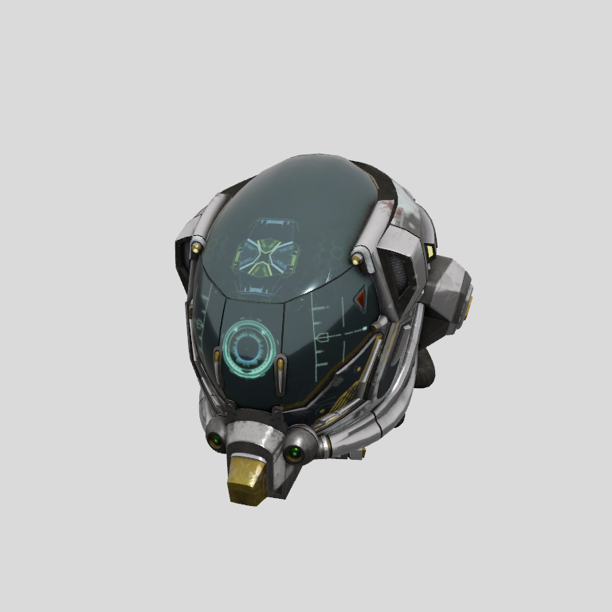
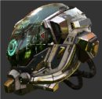
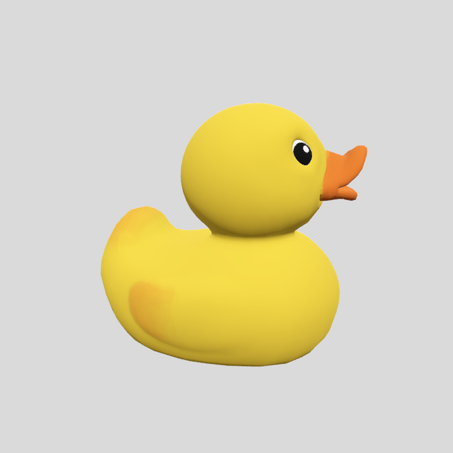
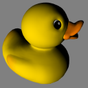
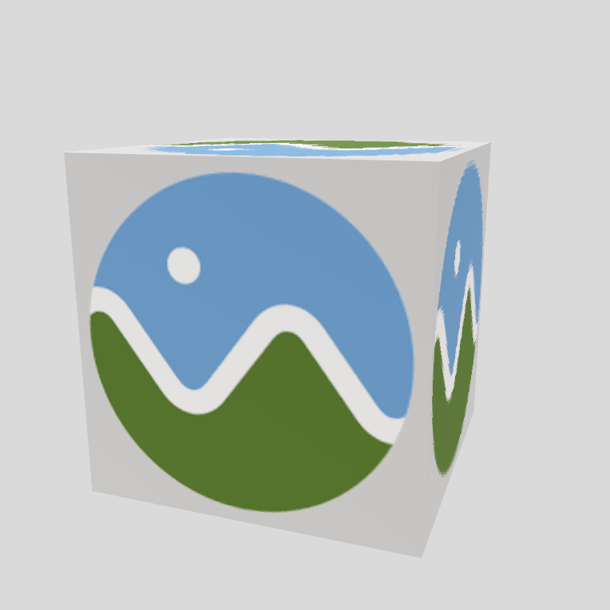
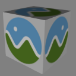
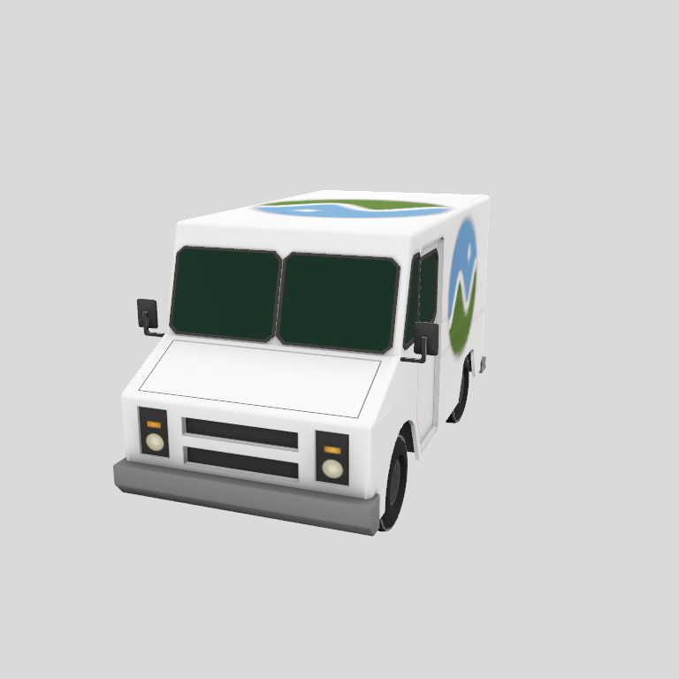
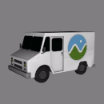

# ADR 0002: Spike B — GLTFKit2 → RealityKit (Gate B)

- **Status:** Proposed. Waiting for Marc's manual checks and decision.
- **Date:** 2026-10-17
- **Spec:** Phase0-Spec §10 (ModelViewer3D, camera contract, Phase 1 3D spike, corpus), §11 P1 / Gate B, §13, §14 risk 2
- **Code:** `Spikes/SpikeB/` (standalone Swift package; no dependency on `SplitKit/` or `SplitKitViews/`)
- **Toolchain used:** Xcode 27.1 (27A9275), Apple Swift 6.4 (swiftlang-6.4.0.34.1), `// swift-tools-version: 6.2`, Swift 6 language mode, `.macOS(.v26)`

## Context

§10 picks GLTFKit2 + RealityKit for ModelViewer3D (SceneKit is soft-deprecated; there is no silent switch to SceneKit). §11 asks Spike B to check four things before any ModelViewer3D work:

- the exact conversion API on Xcode 27.1;
- the camera contract, comparing native camera modes with custom gestures;
- the §10 corpus criteria;
- a load-time error path.

Gate B: **go if the camera contract and the required §10 corpus rows pass.**

## 1. Conversion API (verified on Xcode 27.1)

GLTFKit2 0.5.15 is a binary xcframework. Its RealityKit converter is Swift, shipped in the module interface `GLTFKit2.xcframework/macos-arm64_x86_64/GLTFKit2.framework/Modules/GLTFKit2.swiftmodule/arm64-apple-macos.swiftinterface`, quoted verbatim:

```swift
// swift-compiler-version: Apple Swift version 6.2.1 effective-5.10
// swift-module-flags: -target arm64-apple-macos11.0 ... -swift-version 5 ... -module-name GLTFKit2
@_hasMissingDesignatedInitializers @available(macOS 12.0, iOS 15.0, *)
public class GLTFRealityKitLoader {
  public static func load(from url: Foundation.URL) async throws -> RealityFoundation.Entity
  @_Concurrency.MainActor public static func convert(scene: GLTFKit2.GLTFScene) -> RealityFoundation.Entity
  @_Concurrency.MainActor public static func convert(scene: GLTFKit2.GLTFScene, asset: GLTFKit2.GLTFAsset?) -> RealityFoundation.Entity
  @objc deinit
}
```

The parser is Objective-C (`GLTFAsset.h`): `+ (nullable instancetype)assetWithURL:(NSURL *)url options:(NSDictionary<GLTFAssetLoadingOption, id> *)options error:(NSError **)error;`. Swift imports it as `GLTFAsset(url:options:) throws`.

**The API the spike uses:** both of these compile under Swift 6 mode with `@preconcurrency import GLTFKit2`, and both are exercised by tests.

```swift
let asset = try GLTFAsset(url: url, options: [:])                         // parse (throws NSError, GLTFErrorDomain)
let entity = GLTFRealityKitLoader.convert(scene: asset.defaultScene!, asset: asset)  // @MainActor
// or, one call:
let entity = try await GLTFRealityKitLoader.load(from: url)
```

`convert(scene:asset:)` is the form to use. The `asset:` argument is what carries animations: without it, `availableAnimations` is empty. The two-step form also lets us time parsing and conversion separately and inspect `extensionsRequired` before converting (`SpikeBCore/ModelLoader.swift`). `load(from:)` is covered by `officialAsyncLoaderAPI()`.

## 2. Camera decision: **custom controller**

### Native `realityViewCameraControls` (from the macOS 27.1 SDK interfaces)

These facts come from `RealityFoundation.swiftinterface` and `_RealityKit_SwiftUI.swiftinterface`:

- `public struct CameraControls : Hashable, Sendable { static var none, tilt, pan, orbit, dolly }`. It is **not an `OptionSet`**: one view applies exactly one mode, and there is no API to combine them.
- `RealityViewCameraContent.cameraTarget: Entity?` sets the pivot entity.
- There is **no** API to:
  - read or set the native camera pose;
  - reset the pose;
  - configure near/far dolly limits;
  - remap inputs.

| Contract action | Native modes | Custom controller (`OrbitCameraController`) |
|---|---|---|
| Orbit around target (one-finger drag / left-drag) | `.orbit` around `cameraTarget`: plausible. Input mapping is undocumented, so this needs a MANUAL check. | ✅ `orbit(deltaX:deltaY:)`. Distance and target are invariant (unit tests). |
| Pan, target and camera together (two-finger scroll; ⇧/middle-drag) | `.pan` is a separate mode, exclusive with `.orbit`. Orbit + pan in one view is not expressible. Whether the target moves is not observable. ❌ | ✅ `pan(...)`. Target and camera move by the same vector, in the view plane, scaled to target depth (unit tests). |
| Dolly toward target, never through, clamped near/far (pinch; wheel) | `.dolly` is a separate mode with no clamp configuration. ❌ | ✅ `dolly/scrollZoom/pinch`. Clamped to `[0.1·r, 10·framed]`. Never crosses the target (unit tests). |
| Reset pose **and** target to the bounding-sphere fit (toolbar, ⌘0) | No reset API. The only workaround is rebuilding the `RealityView` (`.id(...)`), which returns to RealityKit's default, not our framing. ❌ | ✅ `reset()` restores the exact framed state and transform (unit test, bit-exact `==`). |

**Decision:** custom gestures. The demo keeps the native modes behind a toolbar picker so Marc can compare them by hand (checklist §3).

The custom controller drives an `Entity` with a `PerspectiveCameraComponent` inside the `RealityView`. Input comes from a transparent AppKit overlay (`SpikeBDemo/CameraInputView.swift`):

| Input | Action |
|---|---|
| `mouseDragged` | orbit |
| ⇧ + `mouseDragged`, `otherMouseDragged` | pan |
| `scrollWheel` with `hasPreciseScrollingDeltas` (trackpad) | pan |
| `scrollWheel` without precise deltas (mouse wheel) | dolly |
| `magnify` | dolly |

Framing uses this distance, so the sphere fits the narrower FOV:

`d = r · 1.05 / sin(min(fov_v/2, atan(tan(fov_v/2)·aspect))), r = ½ AABB diagonal`

### What is automated vs manual

- **Automated:** all of the controller maths, in 12 unit tests (`CameraControllerTests`). Line coverage of `OrbitCameraController.swift` is 100%.
- **Not automated (MANUAL-PENDING):**
  - the event mapping on a real trackpad and mouse;
  - whether `RealityView` on macOS renders through the custom camera entity.

  The app compiles but was **not launched** in this session (no display interaction available).

## 3. Corpus results (§10)

The figures below were measured on this machine (local Mac in this session) by `swift test` in `Spikes/SpikeB`, from `SPIKEB-RESULT` lines:

- Load time = `GLTFAsset(url:options:)` + `convert(scene:asset:)`, on the main actor.
- Box is the first model loaded in the process, so its time includes Metal/RealityKit warm-up.
- Bounding-box deviation is max per-axis |Δmin|, |Δmax| divided by the reference diagonal.
- The reference is computed independently from the glTF JSON: POSITION accessor min/max × node world matrices (`ReferenceGeometry.swift`).

| Feature | Required | Criterion | Evidence | Result |
|---|---|---|---|---|
| Meshes, node hierarchy, transforms | Required | Bounding box within 1% of reference | `requiredModelLoads` ×5. Deviation **0.0000%** for Box, BoxTextured, Duck, DamagedHelmet, CesiumMilkTruck. `nodeHierarchyTransforms`: 6/6 CesiumMilkTruck node world matrices equal the entity world transforms (< 1e-4). | **PASS** |
| … orientation | Required | Correct orientation (+Y up) | `yUpOrientation` ×5. Root transform is identity. Per-axis min/max match (sign-sensitive). Extents (x,y,z): Duck 1.6548/1.5404/1.1525, DamagedHelmet 1.8900/1.8020/2.0000 (its node carries a Z-up→Y-up rotation, which is applied correctly), truck 2.7920/2.6532/4.8689, identical to the reference. | **PASS** |
| PBR metallic-roughness, base colour/normal/ORM textures | Required | Visually matches reference render (side-by-side) | DamagedHelmet: all 6 texture slots converted (base colour, MR→roughness+metallic, normal, occlusion, emissive). Offscreen RealityKit renders are in `assets/spikeB/renders/`, Khronos screenshots in `assets/spikeB/reference/` (table below). The visual judgement is Marc's. | **MANUAL-PENDING** |
| External `.bin`/textures (`.gltf`) | Required | Loads with no missing-texture warnings | Box (`.bin`): 0/0 slots. BoxTextured (`.bin` + png): 1/1. CesiumMilkTruck (`.bin` + jpg): 3/3. 0 warnings each. Negative control `missingTextureIsReported`: removing the png gives 2 warnings, so the detector works. | **PASS** |
| Embedded (`.glb`) | Required | Loads with no missing-texture warnings | Duck 1/1, DamagedHelmet 6/6, 0 warnings. | **PASS** |
| Load time | Required | ≤ 2 s for models ≤ 20 MB | Ranges over the `swift test` runs in this session: Box 132–147 ms (cold), BoxTextured 15.7–17.4 ms, Duck 5.8–9.0 ms (120 KB), DamagedHelmet **151.0–155.6 ms** (3.8 MB), CesiumMilkTruck 43.9–45.6 ms. All ≤ 2 s, asserted. Marc to confirm this Mac is the reference MacBook. | **PASS** (on this Mac) |
| Malformed or unsupported file (incl. `.fbx`) | Required | Clear in-pane error, no crash | Typed `ModelLoadError` thrown, no crash: `malformed.gltf` → `.malformed(1003 invalid JSON)`; `fake.fbx` → `.unsupportedFormat("fbx")`; FBX bytes renamed `.glb`/`.gltf` → `.malformed(1003)`; missing external `.bin` → `.malformed(1007 I/O)`; missing file → `.fileNotFound`; Draco → `.unsupportedRequiredExtensions`. The in-pane display (demo `ContentUnavailableView`) is checklist §5. | **PASS** (automated part) / display **MANUAL-PENDING** |
| Skinning / animation | Optional | Plays or reported unsupported | CesiumMan, RiggedSimple: skins converted, 1/1 animations in `availableAnimations`. Hosted in `RealityRenderer`, `playAnimation` → `isPlaying == true`, `time` 0.300 s after 10 steps. Visual correctness is checklist §6. | **PASS** (plays) |
| Morph targets | Optional | Plays or reported unsupported | AnimatedMorphCube loads without crash. The converter has `// TODO: Morph targets` and skips weight channels. Reported as `unsupportedFeatures = ["morph targets"]`. | **PASS** (reported unsupported) |
| KHR extensions | Optional | Gap documented per extension | See §4. | **PASS** (documented) |
| 2 Artifex exports | (corpus) | n/a | **Not available** to the implementer. | **GAP** |

### Side-by-side (PBR)

| Model | RealityKit (this spike, framed default, procedural studio IBL + 1 directional light) | Khronos reference screenshot |
|---|---|---|
| DamagedHelmet |  |  |
| Duck |  |  |
| BoxTextured |  |  |
| CesiumMilkTruck |  |  |

Lighting and view angle differ from the Khronos screenshots, which use different viewers and environments. The check is about materials and textures (correct maps, orientation, colour space), not pixel equality. The renders are regenerated with `swift run SpikeBRender`.

## 4. KHR extension gaps (GLTFKit2 0.5.15 RealityKit path)

| Extension | Behaviour | Evidence |
|---|---|---|
| `KHR_materials_transmission` | Parsed (`GLTFMaterial.transmission`) but **not converted**. Renders opaque. Reported in `unsupportedFeatures`. | `transmissionIsParsedButNotConverted` (TransmissionTest.glb); converter source |
| `KHR_materials_clearcoat` | **Converted** to `PhysicallyBasedMaterial.clearcoat` / `clearcoatRoughness`, factors and textures. The clearcoat normal texture is ignored. | `clearcoatIsConverted`: 6 materials with clearcoat > 0 |
| `KHR_draco_mesh_compression` | GLTFKit2 needs an external decoder class (`GLTFAsset.dracoDecompressorClassName`) and ships none. Files that require Draco are rejected by GLTFKit2 itself (error 1012). The spike maps that to `.unsupportedRequiredExtensions(["KHR_draco_mesh_compression"])`. | `dracoIsRefused` (Box, Duck glTF-Draco) |
| `KHR_texture_basisu` (KTX2) | The converter has a KTX2 path (`GLTFImage.newTexture(with:)` → `LowLevelTexture` → `TextureResource`, macOS 15+). **Not tested:** no small KTX2 sample was cheap enough for the corpus. | converter source only |
| Others seen | `KHR_xmp` (metadata only) is reported as unconverted. The converter also ignores: sheen (`// TODO: sheen`), volume, iridescence, anisotropy, specular, `KHR_texture_transform`. Alpha `BLEND` uses a constant opacity of 1.0 (`// TODO`). | converter source |

## 5. Proposed spec pin: GLTFKit2 0.5.15 (tag 2026-01-14, commit e69e354)

`.package(url: "https://github.com/warrenm/GLTFKit2.git", exact: "0.5.15")`:

- `Package.resolved` revision `e69e354c4f31ea07b7816b8cbe2ddb28e897d073`.
- Binary target `GLTFKit2.xcframework.zip` with checksum `9d0c338282acce4986494aa02a5f1495278f56c60d43f31453fefea6875b4928` (from GLTFKit2's manifest).

The commit was verified from `Package.resolved`. The tag date comes from the task brief and was not re-checked here. Use `exact:` because the converter's behaviour (gaps above, error codes) is part of what this ADR verified. Adding this pin to §1/§10 needs Marc's approval; it replaces the `TODO` in `SplitKitViews/Package.swift`.

## 6. Risks

1. **Crash paths inside GLTFKit2.** These were not hit by the corpus, but they exist in `GLTFRealityKit.swift`:
   - `convert(scene:)` calls `fatalError` if any node conversion throws, e.g. `MeshResource.generate` on a primitive with no usable positions, such as non-float `KHR_mesh_quantization` data.
   - `GLTFRealityKitResourceContext.init` calls `fatalError` without a Metal device.

   A valid-but-unusual file can therefore crash the host. **P4 mitigations:**
   - refuse unsupported `extensionsRequired` up front (done here for Draco; add `KHR_mesh_quantization`);
   - validate accessor component types before converting;
   - consider an upstream fix.
2. **Main-thread work.** `convert` is `@MainActor`. DamagedHelmet blocks the main actor for about 150 ms. P4 should parse off the main actor and keep only the conversion on it, or show a placeholder.
3. **Custom camera rendering in `RealityView`.** It is unverified that macOS `RealityView` uses a `PerspectiveCameraComponent` entity added to its content. This is checklist step 2.1.

   **Fallback if it doesn't:** apply the inverse of `OrbitCameraController.transform` to the scene root instead of moving a camera. The maths is identical, and `RealityRenderer` already renders through the camera entity.
4. **Trackpad vs mouse disambiguation** uses `hasPreciseScrollingDeltas`. A Magic Mouse reports precise deltas, so its surface scroll pans instead of zooming. Pinch is unavailable on mice. To be judged by hand (checklist §2).
5. **Silent texture loss.** GLTFKit2 drops textures it can't decode without any diagnostic. The spike's `TextureAudit` (glTF material slots vs. converted RealityKit slots, plus image decode) is the only signal. ModelViewer3D should keep it.
6. **Binary dependency.** It is a prebuilt xcframework, built with Swift 6.2.1 in Swift 5 mode, so `@preconcurrency import` is needed. Pinning `exact:` with SwiftPM's checksum guards integrity, not provenance.

## 7. Deviations and gaps (for Marc's approval)

- **`Spikes/` directory.** It is not in the §2 repo layout. It holds a standalone, throwaway package, as §10 asks ("standalone, no SplitKit"). P4 moves what's kept into `SplitKitViews/Sources/ModelViewer3D`.
- **Fixture location.** Fixtures are under `Spikes/SpikeB/Fixtures` (7.0 MB, committed, licences in `Fixtures/LICENSES.md`), not `SplitKitViews/Tests/Fixtures`. P4 should move or re-fetch them there.
- **2 Artifex exports.** Not available. This corpus gap stays open until Marc supplies them.
- **KTX2.** Not exercised by a test file.

## Recommendation: **GO** (conditional on the manual camera checks)

Every automatically verifiable required §10 item passes:

- bounds;
- +Y up;
- hierarchy;
- external and embedded resources with no missing textures;
- load time;
- typed errors with no crash.

The optional rows are either working (skinning/animation, clearcoat) or reported unsupported (morph, transmission, Draco). Nothing found blocks the manual camera checks:

- The custom controller covers every contract action and is unit-tested.
- The only open technical question (risk 3) has a known fallback.

Native `realityViewCameraControls` cannot meet the contract (single mode, no reset, no clamp), so ModelViewer3D should use the custom controller.

**Gate B becomes final GO** when Marc's checklist (`Docs/Manual/SpikeB-checklist.md`) passes on trackpad and mouse, and the PBR side-by-side is accepted. If either fails, this turns into a NO-GO deviation report with these options:

- (a) the scene-root-transform fallback for the camera;
- (b) different input mapping;
- (c) accept the PBR differences as documented gaps.

There is no SceneKit switch.
