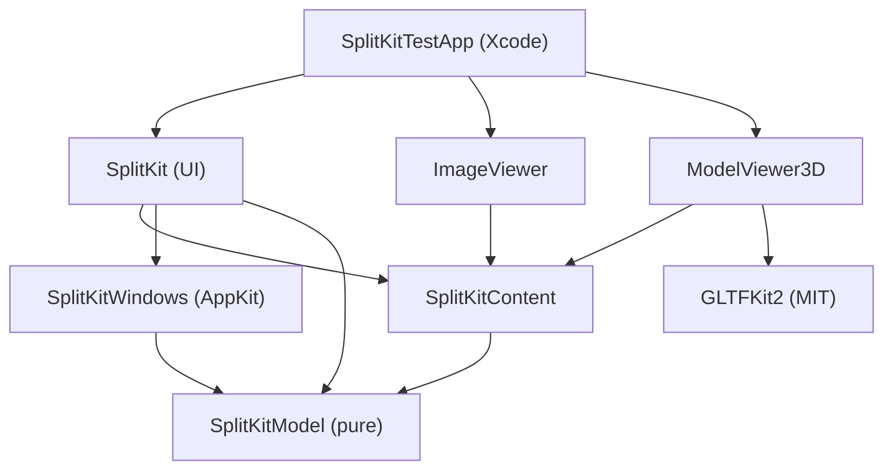

# SplitKit: Phase 0 Specification

**Status: Approved — Revision 4 (17 Oct 2026), ready for Phase 1.**
Revision 1 was approved on 16 Oct 2026. Revisions 2 and 3 resolve two external reviews that Marc accepted. Revision 4 resolves Claude's pre-Phase 1 review (15 items). Implementation started with Phase 1 (§11). Marc approved Revision 4 on 17 Oct 2026.

**Goal:** (1) get **SplitKit 100% right**, and (2) validate the spec → prototype process (Grok Bot coordinating Claude).

---

## Revision 4 changelog

Resolves Claude's pre-Phase 1 review (items 1–15). **D:** marks a design choice made in this revision where the review left options.

1. **Missing transactions (blocker).** Added `insertIntoEmptyWindow`, `moveIntoEmptyWindow` (dock into an empty main window), `beginCloseWindow` / `commitCloseWindow` / `cancelCloseWindow` with runtime `pendingWindowCloses`, and `openMainWindow`, each with a §6.2 row and new `LayoutError` cases (`windowClosePending`, `noWindowCloseInProgress`, `windowNotEmpty`, `mainWindowExists`, `windowIDInUse`). §6.3.4–5 rewritten around them (§5, §6.2, §6.3). **D:** separate `…IntoEmptyWindow` cases rather than an optional `at: PaneID?`, so every existing case keeps a non-optional target. **D:** placeholders and empty panes aren't asked `shouldClose()` during a window close; a window with no hosted content commits without asking.
2. **Fatal vs recoverable violations (blocker).** `InvariantViolation` is fully listed with `isFatal`. `Migrator.decode` returns `(Session, [Normalization])` and throws `.invalid` only for fatal violations; orphan records and dangling focus are repaired and reported. Unknown-type marking and auto-restore moved to the SplitKit layer (registry). §6.1.5 no longer mentions live objects (§5, §6.1, §8, §12).
3. **ID source (blocker).** `SessionEngine.apply` takes `ids: inout some IDGenerator` (`SystemIDGenerator` in the app, `SeededIDGenerator` in tests) for every new `PaneID`/`SplitID`, with a fixed draw order (§6.1.9). **D:** `WindowID`s (detach, open main window) and `ContentID`s stay caller-supplied, as `detach(to:)` already was; the generator's own state isn't "app state" for the failed-transaction rule (§5, §6.2, §13).
4. **Undefined types (blocker).** Defined `DragSessionID` (runtime only, not Codable), every `Normalization` case, every `InvariantViolation` case, and `RestoreReport` (owned by the SplitKit UI target, since it reflects the registry). `WorkspaceRuntime` and `PersistenceError` are now `Equatable` (§5).
5. **Content record lifecycle (major).** New §6.5: inserts carry `NewContent` (id, type, stateVersion) and append the record in the same transaction; snapshots only refresh `state`; closes remove the record. **D:** the record starts with empty `state` ("not captured yet"); the workspace runs `apply` first, creates the object only on success, and discards the result if creation fails. **D:** `.unavailable` content can be moved, swapped, detached, docked and closed like any content (§5, §6.2, §6.5).
6. **Tree arithmetic (major).** New §6.1.9: edge → axis mapping and before/after order, edge-insert halving, proportional redistribution on removal, collapse then flatten, reorder `to` = final index, the nearest-sibling rule, plus a worked example.
7. **Detached-window emptying contradiction (major).** Rule: a detached window in which no pane hosts content is removed and listed in `windowsClosed`, as a result and never an error. `wouldEmptyDetachedWindowIllegally` is **deleted** (§5, §6.1.6).
8. **Window-level invariants (major).** New §6.1.8: zero or one `.main` window, zero windows valid, unique IDs across windows, `windows` in creation order and part of equality and encoding. Matching violations added. **D:** at most one main window, so *File ▸ New Window* means "bring forward or open the one main window". Multi-main-window support would be a later API change.
9. **`DisplayPlacement.resolve` (major).** §9 now states the coordinate space (AppKit global, points, bottom-left of the primary display), `isMain` = primary display, `relativeOrigin` = point offset, the target-display order, nil cases, and the size/translate formulas. **D:** a missing display keeps the same point offset on the main display (then pulled inside); "centred" applies only when `relativeOrigin` is nil.
10. **v0 fixture (major).** **D:** defined a minimal synthetic, test-only v0 (no `version` key, single root + contents) and its v0 → v1 migration with a fixed main `WindowID`, rather than dropping the test (§8, §13).
11. **`Axis` → `SplitAxis` (major).** Renamed in §5. The JSON key stays `axis`.
12. **CI toolchain (major).** Marc's decision: CI runs on GitHub's `xcode-27` preview image and accepts any Xcode 27.x until 27.1 is available there (`actions/runner-images#14850`), with the exact `xcodebuild -version` assertion and a red-CI fallback to Marc. Local development stays on Xcode 27.1. tools-version stays 6.2 with no 6.4 path in P1. Also noted: the dev Mac runs macOS 27.0.1 while the deployment target stays macOS 26 (§1, §13, §13.1 R-TOOL, §14.5).
13. **Self-drop vs pending close (minor).** Accepted Claude's suggestion: a self-drop of content that isn't hosted throws `unknownContent`; a self-drop on a pending pane is still a no-op (§6.2, §6.3.3).
14. **Locations and bookkeeping (minor).** Added `Spikes/SpikeA-LiveTransfer/`, `Spikes/SpikeB-RealityKit/`, `Docs/ADR/` and `CLAUDE.md` to §2. The GLTFKit2 pin is set by Spike B (`exact:`/`revision:`, §10). The P0 row now says Revision 4. `Docs/Traceability.md` is created in the P1 skeleton PR (§2, §10, §11).
15. **Encoding and tooling (minor).** Fixed encoder setup via `Migrator.encode` (`.sortedKeys`, `.prettyPrinted`, `.withoutEscapingSlashes`); CoreGraphics geometry encodes as nested arrays; `SplitKitModel` may use CoreGraphics geometry types; Swift Testing + `swift test --enable-code-coverage` + `llvm-cov`, gate = `SplitKitModel` line coverage (§2, §5, §8, §13).

Traceability (§13.1): R-TREE, R-TXN, R-CLOSE, R-PERSIST, R-WIN and R-TOOL rows updated; R-IDS and R-RECORD added.

## Revision 3 changelog

1. `pendingCloses` moved out of the Codable `Session` into runtime-only `WorkspaceRuntime` state (§5, §6.3).
2. **Unknown-content recovery** is an explicit `.unavailable` pane placeholder. It keeps the `ContentID`, `ContentType` and serialized state, but nothing is hosted. It offers **Restore** when the registry gains the type and restores automatically on relaunch. It is distinct from genuinely orphaned records, which are dropped (§5, §8).
3. **Concrete toolchain:** `// swift-tools-version: 6.2` in both manifests, built with Xcode 27.1 / Swift 6.4 in Swift 6 language mode. CI is pinned to the same Xcode (§1).
4. **3D camera contract** replaces the fixed `.realityViewCameraControls(.orbit)` call: orbit, independent pan, zoom/dolly, reset (pose + target), and a verified mouse/trackpad mapping. Phase 1 Spike B decides between native control modes and custom gestures (§10).
5. **Atomic save:** the first save creates the file by writing a temp file and moving it into place. Later saves use `replaceItemAt`. A failed write always preserves the previous valid session (§8).
6. **Failed transactions leave the whole observable app state unchanged** (ownership, windows, pending close, lifecycle callbacks), with new integration tests (§6.2, §13).
7. **Self-drop is always a no-op** (every edge and centre). Edge of a different pane = move + split; centre of a different pane = swap, or a move if it's empty. A cross-window dock applies the same semantics atomically across both trees (§6.2).
8. Added a manual usability check for ⌘W / ⇧⌘W / last pane / detached window, with menu labels and prompts (§7.5, §13).
9. The two Phase 1 spikes are explicit **go/no-go gates** (§11). The traceability checklist was updated (§13.1).

## Revision 2 changelog

1. **Package graph fixed (no cycle).** There is a new UI-neutral target and product, `SplitKitContent`, in the SplitKit package. It holds the content contract. The SplitKit UI and every SplitKitViews product depend on it. `ContentKit` is removed. The diagram and text are updated (§3).
2. **One canonical API section (§5).** Every public type appears once, with its owning target. Duplicate `PaneToolbarItem`/`PaneContent` declarations are gone. `ContentRegistry` is fully defined (registration, duplicates, unknown types, errors).
3. **Layout operations are transactions (§6)**, each with preconditions, result, content ownership and failure cases. **Decision: a centre drop swaps** the two contents. Same-axis splits are flattened. Invalid operations throw; there are no silent repairs.
4. **Tree invariants (§6.1):** flattening, fraction rules (NaN/zero/negative rejected), point units, a window smaller than the sum of minimum sizes, and empty pane vs `root == nil`.
5. **Two-stage close (§6.3):** an async `shouldClose` that never mutates the tree, then commit and release. Defines what happens to concurrent operations on a pending pane.
6. **Persistence hardened (§8):** session invariants, validation before restore, the original file kept on recovery, atomic writes, defined snapshot points, and a consistent layout+content snapshot.
7. **State ownership (§6.4)** split into content object, SwiftUI view-local and serialisable state, and proven with a counter test.
8. **Focus model (§7.3):** two explicit fields, `activePane` (keyboard/selection) and `focusModePane` (fill-window). Behaviour on resize, display change, native full screen and persistence is defined.
9. **Windows (§9):** deterministic placement fallback (reachability wins; size is clamped). The saved frame, actual frame and re-persisted frame are kept separate to prevent drift. Window ownership is defined for SplitKit-managed and host-managed modes.
10. **Theming scoped down:** `.glass` and `.plain` ship first; `.compact` is later. A small, stable token set. Custom toolbar views are optional in milestone 1, and the macOS 26 glass APIs and accessibility are verified with a small example (§7.2).
11. **Phases reordered (§11):** P1 model + feasibility spikes (cross-window live-content transfer, RealityKit/GLTFKit2), P2 usable split UI, P3 detach/dock/displays, P4 real contents, P5 optional spatial.
12. **3D spike and corpus** with required vs optional glTF features and measurable criteria (§10). Added a public error model, a default shortcut table with collision tests, per-product clean consumer tests, a traceability matrix and reporting rules (§12–13).

---

## 1. Decisions in force

| Area | Decision |
|---|---|
| Repo | Public GitHub `mdidillon/SplitKit`, **MIT**. Independent of Larevo, which is not a dependency and is not modified. |
| Platform | **macOS 26 Tahoe minimum** (deployment target stays macOS 26). No legacy support: no shims, fallbacks or availability branches. Marc's development Mac runs **macOS 27.0.1**, so local runs exercise a newer OS than the target; CI (below) runs whatever macOS the `xcode-27` image ships, and every report records both OS versions. Any behaviour seen only on macOS 27 is recorded as a known gap, never worked around with availability branches. |
| Toolchain | **Xcode 27.1**, Swift 6.4, **Swift 6 language mode** for local development. Manifests declare **`// swift-tools-version: 6.2`** literally in both packages; there is **no 6.4 tools-version path in P1** (raising it later is a deviation report). |
| CI | GitHub-hosted **`runs-on: xcode-27`** (the Xcode 27 preview image). Hosted images did not offer Xcode 27.1 when PR 1 was opened (tracked in `actions/runner-images#14850`), so CI **accepts any Xcode 27.x**: it selects the newest `/Applications/Xcode*.app` whose version is `27` or `27.*` with `xcode-select`, prints `xcodebuild -version` and `swift --version` into the job summary, and fails unless `xcodebuild -version \| head -n 1` matches `^Xcode 27(\.\|$)`. Once a final Xcode 27.1 is on the image, the assertion tightens to `^Xcode 27\.1(\.\|$)` in a one-line PR. **Fallback:** if the `xcode-27` image disappears or no 27.x is found, CI goes red and Marc decides (e.g. a self-hosted runner on his Mac) via a deviation report; there is no silent toolchain change. |
| Structure | `SplitKit/` and `SplitKitViews/` are separate, extractable Swift packages. `SplitKitTestApp/` is a plain **Xcode project**, used as both the test app and the integration sample. |
| Views | One product per content view. First contents: **ImageViewer** (display only) and **ModelViewer3D** (glTF/GLB via **GLTFKit2 + RealityKit**; FBX out). |
| Header | SplitKit owns it. **Focus toggle in the header**, no maximize button. |
| Look | **Liquid Glass default** using native SwiftUI glass APIs and materials, plus environment design tokens. The Larevo screenshot (`Concept/larevo-glass-reference.png`) is a **reference, not a clone**. |
| Lifecycle | Closing the last pane never quits the app (empty state with an Add button and a menu command). |
| Monitors | Required. Marc tests on a single MacBook screen, so placement is a pure model tested over simulated displays (§9). |

## 2. Repository layout

```text
SplitKit/                        (repo root)
├─ SplitKit/                     Swift package — layout engine, renders no content
│  ├─ Package.swift
│  ├─ Sources/SplitKitModel/     pure Swift (Foundation + CoreGraphics geometry types only): IDs, tree, transactions, persistence, migrations, DisplayPlacement
│  ├─ Sources/SplitKitContent/   content contract: PaneContent, PaneToolbarItem, ContentRegistry (no dependency on SplitKit UI)
│  ├─ Sources/SplitKitWindows/   AppKit: window coordinator, detach/dock sessions, NSScreen → DisplaySnapshot adapter
│  ├─ Sources/SplitKit/          SwiftUI: workspace view, chrome (Chrome/), styles and tokens (Styles/), commands
│  └─ Tests/                     SplitKitModelTests, SplitKitContentTests, SplitKitWindowsTests, SplitKitTests
├─ SplitKitViews/                Swift package — one product per content
│  ├─ Package.swift
│  ├─ Sources/ImageViewer/
│  ├─ Sources/ModelViewer3D/     depends on GLTFKit2
│  └─ Tests/
├─ SplitKitTestApp/              Xcode project: test app + integration sample (local package references)
├─ Spikes/                       Phase 1 throwaway code, never a dependency of any package
│  ├─ SpikeA-LiveTransfer/       Xcode project: two windows, AppKit drag session (may use local SplitKit packages)
│  └─ SpikeB-RealityKit/         Xcode project: GLTFKit2 + RealityKit only, no SplitKit (§10)
├─ Concept/                      concept art and visual references (e.g. larevo-glass-reference.png)
├─ Docs/                         Phase0-Spec.md, Traceability.md, Manual/
├─ CLAUDE.md                     working rules for Claude (summarises §1, §3, §13; the spec wins on conflict)
└─ .github/workflows/ci.yml
```

**SplitKit package products:** `SplitKitModel`, `SplitKitContent`, `SplitKit` (the UI, which includes Windows). **SplitKitViews products:** `ImageViewer`, `ModelViewer3D`.

## 3. Dependency graph

`SplitKitContent` imports Foundation, SwiftUI (only for the `View` and `KeyboardShortcut` types) and `SplitKitModel`. It **never imports the SplitKit UI target**, so content products and the engine UI both depend on the contract and not on each other.



Rules: arrows point at dependencies. No target in `SplitKit/` depends on `SplitKitViews/`. A content product never depends on `SplitKit` (UI). Only the host app links both.

## 4. Concepts

- **Window:** holds one layout tree; its kind is `main` or `detached`.
- **Pane:** a leaf of the tree. It hosts **one content or none** (an empty pane).
- **Content:** a live `PaneContent` object, identified by `ContentID`, with a `ContentType` (e.g. `"image"`). It is owned by the `ContentStore` and hosted in **at most one pane** at a time.
- **Identity:** `PaneID` (the slot), `ContentID` (the instance) and `ContentType` (the kind) are independent. Moving content keeps its `ContentID` and state.
- **Units:** all geometry is in **points** (AppKit/SwiftUI coordinate space). Display scale only matters for snapshot metadata.

## 5. Canonical public API

> **Illustrative Swift, not final code.** This is the *only* place public types are declared; other sections refer to them by name. Signatures may change during implementation only through a deviation report (§13).

```swift
// ───────────── Target: SplitKitModel (Foundation + CoreGraphics geometry types, all Sendable) ─────────────
public struct PaneID: Hashable, Codable, Sendable { public let raw: UUID }
public struct SplitID: Hashable, Codable, Sendable { public let raw: UUID }
public struct WindowID: Hashable, Codable, Sendable { public let raw: UUID }
public struct ContentID: Hashable, Codable, Sendable { public let raw: UUID }
public struct ContentType: Hashable, Codable, Sendable { public let raw: String }   // reverse-DNS, e.g. "splitkit.image"
public enum SplitAxis: String, Codable, Sendable { case horizontal, vertical }   // not `Axis`: avoids a clash with SwiftUI.Axis
public struct DragSessionID: Hashable, Sendable { public let raw: UUID }         // runtime only, never encoded
public enum DropEdge: String, Codable, Sendable { case left, right, top, bottom, center }

public indirect enum LayoutNode: Codable, Equatable, Sendable {
    case pane(id: PaneID, content: ContentID?)
    case split(id: SplitID, axis: SplitAxis, children: [LayoutNode], fractions: [Double])
}

public struct WindowLayout: Codable, Equatable, Sendable {
    public enum Kind: String, Codable, Sendable { case main, detached }
    public var id: WindowID
    public var kind: Kind
    public var root: LayoutNode?          // nil only for .main = empty state
    public var activePane: PaneID?        // keyboard/selection focus
    public var focusModePane: PaneID?     // pane filling the window; tree untouched
    public var placement: SavedPlacement  // see §9
}

public struct NewContent: Equatable, Sendable {            // what an insert adds; becomes a ContentRecord (§6.5)
    public var id: ContentID                                 // caller-generated
    public var type: ContentType
    public var stateVersion: Int                             // C.stateVersion of the registered type
}

public enum LayoutTransaction: Sendable {
    case insert(NewContent?, at: PaneID, edge: DropEdge, in: WindowID)  // edge ≠ .center: split; .center: into empty pane only; nil = new empty pane
    case insertIntoEmptyWindow(NewContent?, in: WindowID)               // .main window with root == nil (empty state ▸ Add)
    case move(ContentID, to: PaneID, edge: DropEdge, in: WindowID)      // .center = swap (§6.2)
    case moveIntoEmptyWindow(ContentID, in: WindowID)                   // dock into an empty main window
    case reorder(splitID: SplitID, from: Int, to: Int)
    case resize(splitID: SplitID, fractions: [Double])
    case beginClose(PaneID)                                             // stage 1, see §6.3
    case commitClose(PaneID)                                            // stage 2
    case cancelClose(PaneID)
    case beginCloseWindow(WindowID)                                     // §6.3.4
    case commitCloseWindow(WindowID)
    case cancelCloseWindow(WindowID)
    case openMainWindow(WindowID /* new */, placement: SavedPlacement)  // File ▸ New Window when no main window exists
    case setFocusMode(PaneID?, in: WindowID)
    case setActive(PaneID?, in: WindowID)
    case detach(PaneID, to: WindowID /* new */, placement: SavedPlacement)
}

public struct Session: Codable, Equatable, Sendable {
    public static let currentVersion = 1
    public var version: Int
    public var windows: [WindowLayout]
    public var contents: [ContentRecord]
}
public struct ContentRecord: Codable, Equatable, Sendable {
    public var id: ContentID; public var type: ContentType
    public var stateVersion: Int; public var state: Data
    public var availability: Availability = .hosted
    public enum Availability: String, Codable, Sendable {
        case hosted        // a live object exists (or will on restore)
        case unavailable   // type not registered: shown as a recoverable placeholder, never hosted, data retained verbatim
    }
}

/// Source of every new PaneID/SplitID the engine creates. WindowIDs and ContentIDs are supplied by the caller.
public protocol IDGenerator { mutating func next() -> UUID }
public struct SystemIDGenerator: IDGenerator { public init() }                // UUID(), used by SplitKitWorkspace
public struct SeededIDGenerator: IDGenerator { public init(seed: UInt64) }    // SplitMix64 → RFC 4122 v4 bits; tests only

public enum SessionEngine {
    /// Pure. Returns the new session or throws; never repairs silently. New IDs come only from `ids`, drawn in the order of §6.1.9.
    public static func apply(_ t: LayoutTransaction, to s: Session, runtime: WorkspaceRuntime,
                             ids: inout some IDGenerator) throws(LayoutError) -> TransactionResult
    public static func validate(_ s: Session) -> [InvariantViolation]          // empty = valid; model-level only (no registry)
}
public struct TransactionResult: Sendable {
    public var session: Session
    public var runtime: WorkspaceRuntime
    public var windowsCreated: [WindowID]      // the coordinator acts on these only after success
    public var windowsClosed: [WindowID]
    public var released: [ContentID]          // contents whose host must dispose them
    public var normalizations: [Normalization] // only the transaction cases below
}

/// Every normalisation SplitKit reports. Transactions produce only the first three; Migrator.decode only the last three.
public enum Normalization: Equatable, Sendable {
    case flattened(SplitID)                // a same-axis child split was merged into its parent; this (child) ID is gone
    case collapsed(SplitID)                // a split left with one child was replaced by that child; this ID is gone
    case normalizedFractions(SplitID)      // resize input with a valid but un-normalised sum was scaled to sum 1
    case droppedOrphanRecord(ContentID)    // load: a record no pane references was removed
    case clearedActivePane(WindowID)       // load: dangling activePane set to nil
    case clearedFocusModePane(WindowID)    // load: dangling focusModePane set to nil
}

/// Runtime-only state: never encoded, never part of `Session` equality.
public struct WorkspaceRuntime: Equatable, Sendable {
    public var pendingCloses: Set<PaneID> = []
    public var pendingWindowCloses: Set<WindowID> = []
    public var activeDrag: DragSessionID? = nil
}

public enum Migrator {
    /// Stepwise vN→vN+1, then validate. Throws only for unreadable/future/failed migration or FATAL violations;
    /// recoverable violations are repaired and returned as normalisations. Never consults the registry.
    public static func decode(_ data: Data) throws(PersistenceError) -> (Session, [Normalization])
    public static func encode(_ s: Session) throws -> Data          // the one encoder setup used everywhere (§8)
}

// All geometry: AppKit global screen space, points, origin at the bottom-left of the primary display, y up (§9).
public struct DisplaySnapshot: Equatable, Sendable { public var id: String; public var frame, visibleFrame: CGRect; public var scale: Double; public var isMain: Bool /* primary display = NSScreen.screens[0] */ }
public struct SavedPlacement: Codable, Equatable, Sendable {
    public var intendedFrame: CGRect          // last frame the USER set, global space
    public var displayID: String?             // hint only
    public var relativeOrigin: CGPoint?       // point offset of intendedFrame.origin from that display's visibleFrame.origin
}
public enum DisplayPlacement {
    public static func resolve(_ p: SavedPlacement, minSize: CGSize, displays: [DisplaySnapshot]) -> CGRect // pure, §9
}

// Errors (§12)
public enum LayoutError: Error, Equatable, Sendable {
    case unknownPane(PaneID), unknownSplit(SplitID), unknownWindow(WindowID), unknownContent(ContentID)
    case contentAlreadyHosted(ContentID), centerInsertIntoOccupiedPane
    case invalidFractions(reason: String), indexOutOfRange
    case paneClosePending(PaneID), noCloseInProgress(PaneID)
    case windowClosePending(WindowID), noWindowCloseInProgress(WindowID)
    case windowNotEmpty(WindowID), mainWindowExists(WindowID), windowIDInUse(WindowID)
}
public enum PersistenceError: Error, Equatable, Sendable {
    case unreadable(underlying: String), unsupportedFutureVersion(Int), migrationFailed(from: Int, reason: String)
    case invalid([InvariantViolation])        // fatal violations only
}
/// Model-level only. `isFatal` decides restore behaviour (§8). After a transaction, ANY violation is an engine bug (§12).
public enum InvariantViolation: Equatable, Sendable {
    // fatal
    case duplicatePaneID(PaneID), duplicateSplitID(SplitID), duplicateWindowID(WindowID)
    case duplicateContentID(ContentID)        // hosted in more than one pane
    case duplicateRecord(ContentID)           // two ContentRecords with one ID
    case missingContentRecord(ContentID)      // a pane hosts an ID with no record
    case singleChildSplit(SplitID)            // fewer than 2 children
    case fractionCountMismatch(SplitID)
    case badFractions(SplitID)                // non-finite, ≤ 0, or sum outside 1 ± 1e-9
    case sameAxisNesting(SplitID)             // the child split
    case nilRootInDetachedWindow(WindowID)
    case detachedWindowWithoutContent(WindowID)
    case multipleMainWindows
    // recoverable (repaired by Migrator.decode, reported as Normalization)
    case orphanRecord(ContentID)
    case danglingActivePane(WindowID), danglingFocusModePane(WindowID)
    public var isFatal: Bool { get }          // false only for the three recoverable cases
}

// ───────────── Target: SplitKitContent (Foundation, SwiftUI types, SplitKitModel) ─────────────
@MainActor public protocol PaneContent: AnyObject, Observable {
    static var type: ContentType { get }
    static var displayName: String { get }
    static var systemImage: String { get }
    static var minimumSize: CGSize { get }                   // points
    static var stateVersion: Int { get }
    init(id: ContentID, restoring state: Data?, stateVersion: Int?) throws(ContentError)
    var title: String { get }
    var toolbarItems: [PaneToolbarItem] { get }              // observed; changes re-render the header
    func makeView() -> AnyView                               // may be called again after re-hosting
    func encodeState() throws -> Data
    func shouldClose() async -> Bool                         // must not touch the layout
    func willRelease()                                       // after commit; tear down resources
}

public struct PaneToolbarItem: Identifiable {
    public enum Kind {
        case button(action: @MainActor () -> Void)
        case toggle(isOn: Binding<Bool>)
        case menu(items: [PaneToolbarItem])
        case custom(minWidth: CGFloat, view: AnyView)        // optional in milestone 1; requires title + fallback action
    }
    public enum Priority: Int, Comparable { case low, normal, high }
    public let id: String
    public var title: String                                 // required: accessibility label, tooltip, overflow label
    public var systemImage: String?
    public var kind: Kind
    public var priority: Priority = .normal
    public var isEnabled: Bool = true
    public var keyboardShortcut: KeyboardShortcut? = nil
    public var fallbackAction: (@MainActor () -> Void)? = nil // used when .custom collapses into overflow
}

public enum ContentError: Error, Sendable {
    case unsupportedFile(URL, reason: String), unreadable(URL), stateIncompatible(version: Int), other(String)
}

@MainActor public final class ContentRegistry {
    public init()
    public func register<C: PaneContent>(_ type: C.Type, accepts: [UTType] = []) throws(RegistryError)
    public var registeredTypes: [ContentType] { get }
    public func type(for url: URL) -> ContentType?           // first registered match wins; deterministic order
    public func make(_ type: ContentType, id: ContentID, url: URL?, state: Data?, stateVersion: Int?) throws(RegistryError) -> any PaneContent
}
public enum RegistryError: Error, Sendable {
    case duplicateType(ContentType)                          // registering the same type twice → thrown, first stays
    case unknownType(ContentType)                            // make() for an unregistered type
    case creationFailed(ContentType, ContentError)
}

// ───────────── Target: SplitKitWindows (AppKit, SplitKitModel) ─────────────
@MainActor public final class WindowCoordinator { /* owns NSWindows in .splitKit mode; drag sessions; screen adapter */ }

// ───────────── Target: SplitKit (SwiftUI; depends on all above) ─────────────
@MainActor @Observable public final class SplitKitWorkspace {
    public init(registry: ContentRegistry, configuration: SplitKitConfiguration) throws(PersistenceError)
    public func restoreOrOpenDefault() -> RestoreReport                      // .splitKit mode
    public func perform(_ command: SplitKitCommand) async throws(LayoutError)
    public func addContent(_ type: ContentType, url: URL?, into: PaneID?) async throws(RegistryError)
    public func restoreUnavailable(_ id: ContentID) throws(RegistryError)    // placeholder ▸ Restore
    public private(set) var runtime: WorkspaceRuntime
    public func saveNow() async throws(PersistenceError)
    public var lastSaveError: PersistenceError? { get }
}
public struct SplitKitView: View { public init(workspace: SplitKitWorkspace, window: WindowID) }   // .host mode

/// Owned by the SplitKit (UI) target because it reflects the registry. Returned by restoreOrOpenDefault (§8).
public struct RestoreReport: Equatable, Sendable {
    public enum Source: Equatable, Sendable { case restoredFile, noFile, persistenceDisabled, defaultAfterError(PersistenceError) }
    public struct Unavailable: Equatable, Sendable {
        public enum Reason: Equatable, Sendable { case typeNotRegistered, restoreFailed(String) }
        public var id: ContentID; public var type: ContentType; public var reason: Reason
    }
    public var source: Source
    public var keptInvalidFile: URL?               // session.invalid-<timestamp>.json, when one was written
    public var normalizations: [Normalization]     // from Migrator.decode
    public var unavailable: [Unavailable]          // placeholders after this restore
    public var autoRestored: [ContentID]           // .unavailable records whose type is registered now
}
public struct SplitKitCommands: Commands { public init(_ ws: SplitKitWorkspace, shortcuts: ShortcutMap = .default) }

public struct SplitKitConfiguration: Sendable {
    public enum WindowManagement: Sendable { case splitKit, host(makeDetachedWindow: (@MainActor (WindowID) -> NSWindow)?) }
    public enum Persistence: Sendable { case disabled, file(URL), custom(any SessionStore) }
    public enum Detach: Sendable { case enabled, commandOnly, disabled }
    public var windowManagement: WindowManagement = .splitKit
    public var persistence: Persistence = .file(.applicationSupportDefault) // App Support/<bundle id>/SplitKit/session.json
    public var detach: Detach = .enabled
    public var undockThreshold: CGFloat = 40                 // pt beyond window bounds
    public var minimumPaneSize = CGSize(width: 160, height: 100)  // per-content minimumSize wins if larger
    public var dividerHitWidth: CGFloat = 8
    public var focusModeEnabled = true
    public var autosaveDebounce: Duration = .seconds(1)
}
public protocol SessionStore: Sendable {
    func load() async throws -> Data?
    func save(_ data: Data) async throws                     // must be atomic for its medium
}

// Styling (SplitKit/Styles)
public protocol PaneHeaderStyle { associatedtype Body: View; func makeBody(configuration: PaneHeaderConfiguration) -> Body }
public protocol PaneDividerStyle { associatedtype Body: View; func makeBody(configuration: PaneDividerConfiguration) -> Body }
public protocol EmptyPaneStyle  { associatedtype Body: View; func makeBody(configuration: EmptyPaneConfiguration) -> Body }
public struct SplitKitTokens: Sendable { public var metrics: Metrics; public var glass: Glass; public var colors: Colors /* §7.2 */ }
// Modifiers: .paneHeaderStyle(_:) .paneDividerStyle(_:) .emptyPaneStyle(_:) .splitKitTokens(_:)
```

## 6. Layout model

### 6.1 Tree invariants (checked by `SessionEngine.validate` after every transaction and on load)

1. Every `split` has **≥ 2 children** and `fractions.count == children.count`.
2. **Same-axis flattening:** a child split never has the same axis as its parent. It is merged into the parent, and its fractions are multiplied by the parent fraction. Transactions return `.flattened(SplitID)` in `normalizations`. On load, a same-axis nesting is a violation (§8), not a silent fix.
3. **Fractions:** every value is finite and `> 0`, and the sum is `1 ± 1e-9`. `resize` with NaN, ∞, ≤ 0 or the wrong count **throws `invalidFractions`**. A valid but un-normalised sum (e.g. 2:1) is normalised and reported as `.normalizedFractions`.
4. **Minimum sizes are not stored in fractions.** At render time, a pane's size is `max(fraction × available, min)` and is compressed proportionally when `available < Σ mins`. Stored fractions are **never rewritten** by layout passes. The window's `contentMinSize` is set to the tree's Σ mins plus chrome, so this case only happens when the system forces a window smaller (e.g. a tiny display).
5. **Ownership:** each `ContentID` appears in at most one pane across **all windows**. Every hosted ID has exactly one `ContentRecord` in `Session.contents`, and every record is hosted by exactly one pane (otherwise it is an orphan). Live objects are not part of the model; the single-host check for objects is in SplitKit (§6.4).
6. **Empty states:** `root == nil` is allowed only for `.main` windows (the empty state with an Add button). `.pane(content: nil)` is an **empty pane** with a placeholder, allowed in any window. **A detached window must host at least one content.** After any transaction, a detached window in which no pane hosts content (all panes empty) is removed from the session and listed in `windowsClosed`; this is a result, never an error (§6.3).
7. `activePane` and `focusModePane` refer to existing panes in that window, or are nil.
8. **Window-level:** `Session.windows` holds **zero or one `.main`** window and any number of `.detached` windows. **Zero windows is valid** (the app stays alive, §6.3.5). `WindowID`s are unique, and `PaneID`s and `SplitID`s are unique across all windows. **Order matters:** `windows` is in creation order (new windows are appended, closed ones removed in place), is part of equality and encoding, and is the order in which windows are restored. `contents` is in insertion order. Window z-order is not persisted.
9. **Tree arithmetic** (deterministic; property tests rely on it):
   - **Edge → axis:** `left`/`right` → `.horizontal` (children laid out left to right); `top`/`bottom` → `.vertical` (children top to bottom). `left`/`top` place the new pane **before** the target, `right`/`bottom` **after** it.
   - **Edge insert:** if the target's parent split has the edge's axis, the new pane joins that parent next to the target and the target's fraction `f` becomes `f/2` + `f/2`. Otherwise the target is replaced by a new split of the edge's axis with children (target, new) or (new, target) and fractions `[0.5, 0.5]`. **ID draw order:** the new `PaneID` first, then the new `SplitID` (only if a split is created).
   - **Removal and collapse:** when a child with fraction `r` is removed, each remaining sibling `fᵢ` becomes `fᵢ / (1 − r)`. If one child remains, the split is replaced by it (`.collapsed`). If that child is a split with the same axis as its new parent, it is merged into the parent with its fractions multiplied by its slot fraction (`.flattened`). Results are divided by their sum so the stored sum stays within `1 ± 1e-9`; this is not reported.
   - **Reorder:** `from` and `to` are indices in the current children; the child is removed at `from` and inserted so that its **final index is `to`** (`0 ≤ to < count`). `from == to` is a valid no-op. Fractions move with their child.
   - **Nearest sibling** (new `activePane` after the active pane is removed): the first leaf, in depth-first order, of the sibling that followed the removed child in its parent; if it was the last child, the last leaf of the preceding sibling. If the window has no panes left, nil.
   - **Worked example:** `H[A 0.5, V[B 0.5, C 0.5] 0.5]`, `insert(D, at: A, edge: .right)` → `H[A 0.25, D 0.25, V[B, C] 0.5]` (draws one PaneID). Closing `C` → `V` collapses to `B` → `H[A 0.25, D 0.25, B 0.5]` (`.collapsed(V)`), and if `C` was active, `activePane = B`. Closing `D` from `H[A 0.25, D 0.25, B 0.5]` → `H[A 1/3, B 2/3]`.

### 6.2 Transactions

| Transaction | Preconditions | Result | Content ownership | Failure cases |
|---|---|---|---|---|
| **Edge insert** (`insert`, edge ≠ center) | Target pane exists; the content ID has no record yet | The target becomes a split (or joins the parent split if it's the same axis, with flattening) and the new pane gets half the target's fraction (§6.1.9) | A `ContentRecord` is appended (§6.5); the new content is hosted; nothing is released | `unknownPane`, `contentAlreadyHosted`, `paneClosePending`, `windowClosePending` |
| **Center insert** | Target pane is **empty** | The content goes into the empty pane | Record appended; hosted | `centerInsertIntoOccupiedPane` (to replace, use the content picker: insert new, then a two-stage close of the old) |
| **Insert into empty window** (`insertIntoEmptyWindow`) | `.main` window with `root == nil` | `root = .pane(newPaneID, content)`; `activePane` = that pane | Record appended (if content) | `unknownWindow`, `windowNotEmpty` (root ≠ nil, or a detached window), `contentAlreadyHosted` |
| **Self-drop** (`move` with T == S, any edge **or** centre) | The content is hosted in S | **Always a no-op**, even if S is pending close: the unchanged session, no normalisations, no callbacks, no snapshot | Unchanged | `unknownContent` if the content isn't hosted anywhere; nothing else |
| **Edge move** (`move`, edge ≠ center) | Content hosted in source pane S ≠ target T | S is removed (collapse/flatten), then an edge insert at T (move + split) | Same `ContentID`; no release | `unknownContent`, `unknownPane`, `paneClosePending` |
| **Move into empty window** (`moveIntoEmptyWindow`) | Content hosted in S; target is a `.main` window with `root == nil` | S is removed from its window (collapse); target `root = .pane(newPaneID, content)` | Same `ContentID`; no release | `unknownContent`, `windowNotEmpty`, `paneClosePending` |
| **Center move = swap** | S ≠ T; both exist | If T has content, **S and T exchange contents**. If T is empty, the content moves and S becomes empty (an empty S in a detached window that would leave it with no content → the window closes after commit) | Both IDs keep their state; **nothing is released or closed** | `paneClosePending` (self is handled by the self-drop row) |
| **Reorder** | Valid split and indices | Children and fractions are permuted together | Unchanged | `indexOutOfRange` |
| **Resize** | Valid split and fractions (§6.1.3) | Fractions are replaced | Unchanged | `invalidFractions` |
| **Detach** | Pane exists and hosts content; detach is enabled; the new `WindowID` is unused | The pane is removed from its window (collapse); a new `.detached` window holds `.pane(newPaneID, sameContent)` and is appended | Same `ContentID` | `paneClosePending`, `windowIDInUse`; detaching the only pane of a main window is allowed (the main window shows its empty state); detaching an empty pane throws `unknownContent` |
| **Open main window** (`openMainWindow`) | No `.main` window exists; the `WindowID` is unused | A `.main` window with `root == nil` is appended (`windowsCreated`) | Unchanged | `mainWindowExists`, `windowIDInUse` |
| **Close window** (`begin/commit/cancelCloseWindow`) | See §6.3.4 | Commit removes the window from `windows` (`windowsClosed`) | All its contents released; their records removed | `unknownWindow`, `windowClosePending`, `noWindowCloseInProgress`, `paneClosePending` |
| **Dock** (cross-window move) | S in window A, T in window B | **Exactly the same semantics as a move** (edge = move + split, centre = swap or move into empty), applied **atomically across both trees in one transaction**. If A is detached and becomes empty, it's listed in `windowsClosed` | Same `ContentID` | As for move; on failure neither tree changes |

**Why swap for a centre drop:** it's the only centre behaviour that is **lossless and synchronous**. It never needs a `shouldClose` confirmation in the middle of a drag, never destroys state by accident, and is undone by dropping again. Replacing content stays an explicit, confirmable action in the content picker. Rejecting the drop entirely would make the centre target useless.

`.unavailable` contents (§8) take part in every layout transaction like any other content: they can be moved, swapped, detached, docked and closed. Only hosting is skipped.

Every transaction is **all-or-nothing**. On throw, the **entire observable app state is unchanged**:
- the `Session` (byte-identical when encoded with `Migrator.encode`) and the `WorkspaceRuntime` (`==`), including pending closes. The ID generator may have advanced; it is not app state;
- content ownership: no content is created, released or re-hosted, and no `willRelease()`/`shouldClose()` is called;
- windows: no `NSWindow` is created, shown, moved or closed. The coordinator applies `windowsCreated`/`windowsClosed` only after a successful result;
- no snapshot or autosave is triggered.

The engine computes everything purely first; side effects happen only after success, in a fixed order (create windows → re-host → release → close windows → snapshot). The model never "fixes" bad input; it either throws or returns a documented normalisation.

### 6.3 Two-stage close

1. `beginClose(P)` marks P **pending** (it's in `WorkspaceRuntime.pendingCloses`, which is runtime-only and never persisted; the tree is unchanged; the header shows a subtle "closing" state). SplitKit then calls `await content.shouldClose()`. The content may show a sheet; it must not mutate the layout.
2. **Accepted →** `commitClose(P)`: the pane is removed (collapse/flatten), its `ContentRecord` is removed, and `released = [contentID]`. The host calls `willRelease()`, then drops the object, and a snapshot is taken. (An `.unavailable` placeholder has no object: SplitKit shows its own confirmation instead of `shouldClose()` and calls no `willRelease()`.)
   **Declined →** `cancelClose(P)`: the pending flag is cleared, and **everything else is untouched**.
3. **While pending:** any transaction that touches P (move, swap, detach, a resize of its parent, a second close) throws `paneClosePending`, except a self-drop on P, which stays a no-op (§6.2). UI drags from P are disabled. Transactions elsewhere proceed normally, because P's `PaneID` is stable.
4. **Closing a window with N contents:** `beginCloseWindow(W)` adds W to `WorkspaceRuntime.pendingWindowCloses` (tree unchanged); it throws `paneClosePending` if any pane in W is already pending. While W is pending, every transaction touching W or its panes throws `windowClosePending`. SplitKit asks each hosted content in tree order (depth-first) with `shouldClose()`; `.unavailable` placeholders and empty panes are not asked (the window prompt covers them, §7.5). If **any declines**, `cancelCloseWindow(W)` and **nothing is closed**. If all accept, `commitCloseWindow(W)` removes W, releases all its contents and removes their records in one transaction. A window with no hosted content commits without asking.
5. **Last pane of a main window** → `root = nil` (empty state); the app stays alive. **Last content of a detached window** → the window closes (§6.1.6). Closing the last window keeps the app running (zero windows is valid); *File ▸ New Window* brings the main window forward if one exists, otherwise applies `openMainWindow`.

### 6.4 State ownership

| Kind | Lives in | Survives move/detach/dock | Persisted |
|---|---|---|---|
| **Content state** (document URL, camera pose, counter value) | The `PaneContent` object (owned by `ContentStore`) | Yes, because the object is never recreated | Yes, via `encodeState()` with a `stateVersion` |
| **View-local** (hover, transient animation, scroll inertia) | SwiftUI `@State` inside `makeView()` | **No**: the view may be rebuilt when re-hosted. Documented as acceptable. | No |
| **Layout state** (tree, fractions, active/focus pane, placement) | `Session` (SplitKitModel) | Yes | Yes |

**Proof test (Phase 1 spike, Phase 3 regression):** a `CounterContent` keeps its count in the object and a "view-local taps" count in `@State`. After split → move → swap → detach → dock → relaunch, the object count is preserved at every step and after relaunch. The view-local count may reset, and the test asserts it is documented rather than relied on. A debug assertion and a unit test check that `makeView()` hosting never exists for one `ContentID` in two windows at the same time.

### 6.5 Content record lifecycle

- **Records live in `Session.contents` from insert onward.** `insert`/`insertIntoEmptyWindow` with a `NewContent` append `ContentRecord(id, type, stateVersion, state: Data(), availability: .hosted)` in the same transaction. Empty `state` means "not captured yet"; restoring such a record passes `state: nil, stateVersion: nil` to `init`.
- **Creating the object:** `SplitKitWorkspace` runs `apply` (pure) first. Only on success does it create the object through `ContentRegistry.make(…, url:)`; if creation throws, the result is **discarded** (session and runtime unchanged) and `RegistryError.creationFailed` is thrown. Otherwise the result is committed and the insert snapshot (§8) fills in `state`.
- **Move, swap, detach, dock, reorder, resize, focus:** the record is untouched.
- **commitClose / commitCloseWindow:** the record is removed in the same transaction, and the ID is listed in `released`.
- **Snapshots** refresh only `state` and `stateVersion` of `.hosted` records. `.unavailable` records are written back verbatim.
- **`unknownContent(ContentID)`** is thrown when a transaction names a `ContentID` that isn't hosted in any pane; **`contentAlreadyHosted`** when an insert names an ID that already has a record.
- **Availability** is changed only by the SplitKit layer, never by `SessionEngine`: marking on restore and `restoreUnavailable` (§8). Each change is followed by a snapshot.

## 7. Pane chrome

### 7.1 Header contents (left → right, one row, default 28 pt)

1. **Drag handle** (grip). Hidden if both rearrange and detach are disabled.
2. **Content icon** (SF Symbol of the type).
3. **Title + ▾**: opens the **content picker / pane menu** (switch content, Add, Split Right, Split Down, Detach, Move to Window ▸, Close).
4. **Content toolbar items** (§7.4), right-aligned and flexible.
5. **Overflow ⋯**: only when content items don't fit. It never holds focus or close.
6. **Focus toggle**: one click, always visible, never in overflow. It enters and exits focus mode for this pane.
7. **Close ×**: always last.

There's no maximize button. An empty pane shows "Add Content" in place of the title and keeps the handle, focus and close. The header also shows active/inactive state, a drop highlight and a pending-close state. Right-click opens the same pane menu.

### 7.2 Theming

- **Code location:** all chrome lives in `SplitKit/Sources/SplitKit/Chrome/` and `Styles/`. `SplitKitModel`, `SplitKitContent` and the content products contain no chrome styling. Host overrides live in the host.
- **Convention (standard SwiftUI):** style protocols that behave like `ButtonStyle` (§5), applied through modifiers that propagate in the environment, plus environment-injected `SplitKitTokens`. Header controls are standard SwiftUI `Button`/`Menu`/`Toggle`; there is no custom component library.
- **Milestone 1 styles:** **`.glass` (default)** uses `glassEffect(_:in:)`, `GlassEffectContainer` and `.buttonStyle(.glass)`, with `Material` for drop overlays. **`.plain`** uses opaque semantic colours. **`.compact` is deferred** to after Phase 3.
- **Stable token set (v1, kept small on purpose):**
  - `metrics.headerHeight`, `metrics.dividerThickness`, `metrics.dividerHitWidth`, `metrics.cornerRadius`, `metrics.contentPadding`
  - `glass.variant` (`.regular`/`.clear`), `glass.tint: Color?`
  - `colors.activeIndicator`, `colors.dropHighlight` (default to accent/tint)

  Any additions are reviewed as API changes.
- **System appearance:** semantic colours only. Light/dark, the accent colour, Increase Contrast, Reduce Transparency and Reduce Motion are honoured through system behaviour, with no custom fallback code.
- **Verification (Phase 2 entry):** a small example screen confirms the exact macOS 26 SDK glass APIs and their behaviour under Reduce Transparency, Increase Contrast and VoiceOver before chrome is built. Any API difference gets a deviation report.
- **Visual reference:** `Concept/larevo-glass-reference.png` shows dark translucent panels, soft gradient tints, rounded cards, compact pill chips and thin dividers. It is used to tune default tokens. **It is a reference, not a clone.**

### 7.3 Focus model

- **`activePane`** is the keyboard and selection focus: the pane whose content holds the first responder, highlighted in its header. It is set by click and ⌥⌘-arrows.
- **`focusModePane`** is the pane filling its window (focus mode). Entering it also sets `activePane` to that pane.
- **Resize:** no effect on either field. **Display change / re-placement:** unchanged. **Native full screen:** independent and combinable; exiting full screen keeps focus mode. **Structural transactions** in that window (insert, move, detach, close) clear `focusModePane` first. A close of the focused pane clears both fields, and `activePane` moves to the nearest sibling (§6.1.9).
- **Persistence:** both fields are persisted. Any dangling reference is set to nil on load (reported as `.clearedActivePane` / `.clearedFocusModePane`).
- **Commands:** header toggle, *Pane ▸ Focus Pane* (⌃⌘F) and Esc to exit (only when the content doesn't consume Esc).

### 7.4 Content toolbar contract

- Content declares `toolbarItems` (§5), and **SplitKit lays them out**. Content never draws free-form into the chrome.
- **Layout:** by priority, then declaration order. Low priority overflows first, the title truncates (middle) before `.high` items collapse, and at minimum width only the handle, icon, ⋯, focus and × remain.
- **Overflow:** `.button`/`.toggle`/`.menu` become menu items. `.custom` (optional in milestone 1) becomes a menu item using `title` + `fallbackAction`; a `.custom` without a fallback is disabled in overflow.
- **Accessibility:** `title` is required and is the VoiceOver label. Custom views must expose one accessibility element. Every item is also reachable under *Pane ▸ ‹Content name› ▸* in the menu bar.
- **First contents:** ImageViewer has none. ModelViewer3D has *Reset Camera* (`.high`, ⌘0 while the pane is active).

### 7.5 Default shortcuts (remappable via `ShortcutMap`)

| Command | Shortcut |
|---|---|
| Add Content… | ⇧⌘N |
| Split Right / Split Down | ⌘D / ⇧⌘D |
| Move active pane focus | ⌥⌘ ← → ↑ ↓ |
| Move pane to edge | ⌃⌥⌘ ← → ↑ ↓ |
| Focus Pane (toggle) | ⌃⌘F |
| Detach Pane | ⌥⌘D |
| Close Pane | ⌘W (closes the pane; the window closes only when it has no panes) |
| Close Window | ⇧⌘W |

**Close semantics and labels:**
- **⌘W, *Pane ▸ Close Pane*:** closes the active pane.
  - In a detached window with one pane, the menu label reads *Close Pane and Window*.
  - On the last pane of a main window, it reads *Close Pane* and leaves the empty state.
- **⇧⌘W, *Window ▸ Close Window*:** closes the whole window.
  - If 2 or more contents ask to confirm, one prompt lists them: "Close window with N panes?" with *Close All* and *Cancel* buttons.
  - A detached window prompt also offers *Dock Back Instead*.
- **⌘W in an empty main window** closes the window. The app stays alive.

**Collision testing:** a unit test asserts there are no duplicates inside `ShortcutMap.default` or against the standard macOS menu shortcuts SplitKit doesn't own. A host-supplied map is validated at startup; conflicts are reported (as a recoverable error) and not silently overridden. Content shortcuts are only active while their pane is active, and a conflict with a SplitKit shortcut makes the content's shortcut lose, with a debug warning.

## 8. Persistence

- **Format:** JSON `Session` with `version`. `Migrator` applies stepwise migrations and then `validate`.
- **Encoding (byte-identical output):** one setup, `Migrator.encode`, used for files, custom stores and every byte comparison in tests: `JSONEncoder` with `outputFormatting = [.sortedKeys, .prettyPrinted, .withoutEscapingSlashes]`, default `.base64` data and default (shortest round-trip) number formatting. Non-finite numbers can't occur (§6.1.3). `CGRect`/`CGPoint`/`CGSize` use their standard Codable form, nested arrays: a rect is `[[x, y], [width, height]]`. `LayoutNode` encodes with Swift's synthesized enum coding (keys `pane`/`split`), so the JSON key for the split axis stays `axis`.
- **Validation before restore** is in two layers:
  - **Model layer (`Migrator.decode`, no registry):** every `InvariantViolation` (§5). **Fatal** ones (duplicate IDs, missing records, bad fractions, structure, window-level rules) throw `.invalid` with the fatal list. **Recoverable** ones are repaired and returned as normalisations: orphan records dropped (`.droppedOrphanRecord`), dangling focus set to nil (`.clearedActivePane` / `.clearedFocusModePane`).
  - **SplitKit layer (registry):** after a successful decode, each `.hosted` record whose `ContentType` isn't registered is marked `.unavailable` (reason `typeNotRegistered`); each `.unavailable` record whose type is registered now is set to `.hosted` and listed in `autoRestored`.
  - **Fatal for the file:** restore **does not proceed** with a partially repaired tree. SplitKit opens the default layout, **keeps the original as `session.invalid-<timestamp>.json`**, and returns `RestoreReport` with `source: .defaultAfterError(.invalid(…))` and `keptInvalidFile`.
  - **Recoverable: unavailable content.** A pane that references a record whose `ContentType` isn't registered keeps its `ContentID` and becomes an **unavailable placeholder**. The record is marked `.unavailable` and its `type`, `stateVersion` and `state` are kept **verbatim**. Nothing is hosted.
    - The placeholder shows the icon, "‹Type› isn't available in this app", and the actions **Restore** (enabled once the registry has the type) and **Close** (removes the pane and its record after confirmation).
    - When the type gets registered at runtime, the placeholder's Restore becomes active. On the next launch, restore is **automatic**.
    - The placeholder is saved back unchanged, so data is never lost across launches.
  - **Orphaned records** (no pane in any window references them) are **dropped** and listed in `RestoreReport.normalizations`. Dangling focus is set to nil. A content whose `init(restoring:)` throws becomes the same unavailable placeholder (reason: "couldn't restore"), with the record retained and Restore offering a retry.
  - **Future version** (`version > current`): the file is never overwritten; SplitKit opens the default layout read-from-scratch and reports `unsupportedFutureVersion`.
- **Migration chain and v0 fixture:** `Session.currentVersion` stays 1. To exercise the chain before a real v2 exists, a **synthetic v0** is defined for tests only (it never shipped): a JSON object with **no `version` key**, `{ "root": LayoutNode?, "contents": [{ "id", "type", "stateVersion", "state" }] }`, i.e. one main window, no placement, no focus fields, no `availability`. A file without `version` is v0. **v0 → v1** wraps it into one `.main` window with `WindowID` `00000000-0000-0000-0000-000000000001` (fixed, so migration stays pure and reproducible), `placement = SavedPlacement(intendedFrame: [[0, 0], [1200, 800]], displayID: nil, relativeOrigin: nil)` (centred on the main display by §9), `activePane = nil`, `focusModePane = nil`, and `availability = .hosted` for every record. The fixture lives at `SplitKit/Tests/SplitKitModelTests/Fixtures/session-v0.json`.
- **Atomic writes:** encode into a temp file in the same directory and fsync it.
  - **First save** (no file yet): create the directory if needed, then atomically move the temp file into place (`FileManager.moveItem`, which is a rename on the same volume).
  - **Later saves:** `FileManager.replaceItemAt(_:withItemAt:)`.
  - **Any failure** (encode, write, move or replace) leaves the previous valid session file untouched and deletes the temp file.
  - A custom `SessionStore` must provide equivalent guarantees, and a conformance test suite ships for that.
- **Consistent snapshot:** on the main actor, the tree and **all** `encodeState()` results are captured in one pass (no awaits in between), then encoded and written off the main actor. Contents that throw in `encodeState` keep their last good state, and the error is recorded.
- **Snapshot points:** after every committed structural transaction (insert, move, swap, detach, dock, commitClose) and after resize ends (mouse-up), debounced at `autosaveDebounce`. Snapshots are also taken on window close and immediately on app quit (`applicationShouldTerminate` waits for at most 2 s, then quits). There are no snapshots mid-drag. While a close is pending, the pane is saved as open, because pending state is runtime-only.
- **Pending and failed saves:** only one write is in flight; newer snapshots replace a queued one. A failure sets `lastSaveError`, retries on the next snapshot point, and never deletes the previous good file.
- **Persistence `.disabled`:** no reads or writes; `restoreOrOpenDefault` opens the default layout.

## 9. Windows and displays

- **Ownership:**
  - In **`.splitKit`** mode, `WindowCoordinator` creates, owns, places and closes all main and detached `NSWindow`s.
  - In **`.host`** mode, the host owns main windows and embeds `SplitKitView(workspace:window:)`. Detached windows are created by SplitKit (or by the host's `makeDetachedWindow` callback). SplitKit only sets frames on windows it created. For host windows it reports `SavedPlacement` but never moves them.
- **Pure placement model:** `DisplayPlacement.resolve(placement, minSize, displays)` in `SplitKitModel`, plus an `NSScreen → DisplaySnapshot` adapter in `SplitKitWindows`.
- **Coordinate space:** AppKit global screen coordinates, in points, origin at the bottom-left of the primary display (`NSScreen.screens[0]`, the one with the menu bar), y up. Other displays may have negative coordinates. `DisplaySnapshot.isMain` means the primary display (not `NSScreen.main`, which follows the key window). `relativeOrigin` is a **point offset** of the window's bottom-left origin from the display's `visibleFrame.origin`.
- **Deterministic fallback** (`vf` = the target display's `visibleFrame`, `size` = `intendedFrame.size`):
  1. **Target display:** the snapshot whose `id == displayID`. If `displayID` is nil or not found → the display with `isMain`; if none is marked main → `displays[0]`. If `displays` is empty, return `intendedFrame` unchanged.
  2. **Origin:** if `relativeOrigin` is non-nil → `vf.origin + relativeOrigin` (on a fallback display this keeps the same offset, which step 4 then pulls inside). If `relativeOrigin` is nil → centred: `(vf.midX − size.width/2, vf.midY − size.height/2)`. (Revision 3's "centred at the same relative position" is replaced by this rule.)
  3. **Size:** first raised to `minSize` per axis, then, if larger than `vf`, **clamped to `vf.size`, even below the content minimum** (reachability wins over minimum size; panes then compress per §6.1.4).
  4. **Translate** so the window is **fully inside `vf`** (the title bar is always reachable): `x = min(max(x, vf.minX), vf.maxX − width)`, same for y. No rounding. That's stricter than the previous 80% rule, so the two never conflict.
  - **Writing a placement:** on a user move/resize, `displayID` = the display containing the largest part of the window (ties → earlier in `displays`), `relativeOrigin = frame.origin − vf.origin`, `intendedFrame = frame`.
- **No drift:**
  - **`intendedFrame`** is what the user last set by moving or resizing.
  - The **actual frame** is the resolved result.
  - Only user-initiated moves and resizes (and detach placement) update `intendedFrame`. System-forced re-placement after a display change **does not overwrite it**, so reconnecting the monitor returns windows to their intended spot.
- **Detach:** dragging a header more than `undockThreshold` pt outside the window shows a ghost window; release creates the window there. *Pane ▸ Detach* places the window offset by 24 pt from the source, then resolved. Escape or a drop outside any valid target **cancels** with no change. A drop over an invalid target is a cancel too.

## 10. Content: first two products

| Product | Scope | Stack |
|---|---|---|
| **ImageViewer** | Display only: aspect-fit, no zoom/pan/rotate. It opens via the picker (file panel) or a dropped image. Unreadable file → `ContentError.unreadable`, shown in the pane. | SwiftUI `Image(nsImage:)`; no dependencies |
| **ModelViewer3D** | **glTF + GLB only, FBX out.** The camera contract is below. | **GLTFKit2 → RealityKit**, in `RealityView`. The camera implementation is decided by Spike B. **GLTFKit2 pin:** `exact: "0.5.15"`, set by Spike B (§11.1); `SplitKitViews/Package.swift` uses `exact:` with that value, no version ranges |

**Why RealityKit:** SceneKit is soft-deprecated (WWDC25; maintenance only), which conflicts with the macOS 26 current-APIs rule. RealityKit can't load glTF natively, so GLTFKit2 (MIT, active, RealityKit converter reworked in 2026) is required.

**Camera contract (required, whatever the implementation):**

| Action | Trackpad | Mouse |
|---|---|---|
| Orbit around target | One-finger drag (click-drag) | Left-drag |
| Pan (move target and camera together, independent of orbit) | Two-finger scroll | ⇧ + left-drag, or middle-drag |
| Zoom/dolly toward target (never through it; clamped near/far) | Pinch | Scroll wheel |
| Reset | Toolbar *Reset Camera* / ⌘0: camera pose **and** target return to the framed default (bounding sphere fit) | same |

The mapping is verified by hand on Marc's MacBook trackpad and a mouse, with results recorded. RealityKit's built-in `realityViewCameraControls` modes (e.g. `.orbit`, `.pan`, `.dolly`) are a candidate, **not a prescription**. Spike B decides whether a combination of native modes meets the contract or whether custom gesture handling (setting a camera entity's transform and target) is needed.

**Phase 1 3D spike (standalone, no SplitKit, in `Spikes/SpikeB-RealityKit/`):** verify the exact GLTFKit2 → RealityKit conversion API on Xcode 27.1; the full camera contract above on a trackpad and a mouse (native modes vs custom gestures); reset (pose + target); `.gltf` with external `.bin` and textures; GLB with embedded textures; a load-time error path.

**Sample corpus and criteria** (Khronos glTF-Sample-Assets subset plus 2 Artifex exports, committed under `SplitKitViews/Tests/Fixtures` or fetched by a script with licences recorded):

| Feature | Required in v1 | Criterion |
|---|---|---|
| Meshes, node hierarchy, transforms | Required | Bounding box within 1% of reference; correct orientation (+Y up) |
| PBR metallic-roughness, base colour/normal/ORM textures | Required | Visually matches the reference render (side-by-side screenshot in the report) |
| External `.bin`/textures (`.gltf`), embedded (`.glb`) | Required | Loads with no missing-texture warnings |
| Load time | Required | ≤ 2 s for models ≤ 20 MB on Marc's MacBook |
| Malformed or unsupported file (incl. `.fbx`) | Required | Clear in-pane error, no crash |
| Skinning/animation, morph targets | Optional | Plays or is reported as unsupported |
| KHR extensions (transmission, clearcoat, Draco, KTX2) | Optional | Gap documented per extension |

If a required item fails, Marc gets a deviation report. There is no silent switch to SceneKit.

**Deferred contents:** terminal (SwiftTerm, MIT; pin it because 2.0 changes the API), code editor (CodeEditorUI is not usable on macOS, since its editor is a placeholder there; Runestone is iOS/Catalyst-first; candidates are CodeEditSourceEditor (MIT) or STTextView (GPL-3/commercial)), browser (`WKWebView`), file browser (SwiftUI + `FileManager`), GitHub integration (new scope).

## 11. Phases

| Phase | Deliverables | Acceptance criteria |
|---|---|---|
| **P0 Spec lock** | This Revision 4 + traceability matrix skeleton (`Docs/Traceability.md`, seeded from §13.1 in the P1 skeleton PR) | Marc approves. Every requirement has an ID. |
| **P1 Model + feasibility spikes** | Repo skeleton (2 packages, Xcode app, CI, `CLAUDE.md`, `Docs/Traceability.md`); full `SplitKitModel` (tree, transactions incl. §6.2 window transactions, validate, `IDGenerator`, migrations v0 → v1, DisplayPlacement); **Spike A** (`Spikes/SpikeA-LiveTransfer/`): cross-window live-content transfer (AppKit drag session; state, first responder/focus handover, cancel and failed drops, cleanup, single host); **Spike B** (`Spikes/SpikeB-RealityKit/`): RealityKit/GLTFKit2 standalone (§10), including the GLTFKit2 pin. Results are recorded in §11.1 | `SplitKitModel` line coverage ≥ 90% (measured per §13) plus property tests green. Spike A demo: a counter and a live 3D view move between two windows with state and responder intact, cancelled drops leave no residue, and there's never a double host (asserted). Spike B meets §10 spike items. Each spike ends in a written result (§11.1) with an explicit **go/no-go gate**:
- **Gate A (live transfer):** go if every criterion passes. No-go → Marc decides between (a) commands-only detach/dock in v1, or (b) a redesign. P2 does not start until he decides.
- **Gate B (3D):** go if the camera contract and the required §10 corpus rows pass. No-go → a deviation report with options. ModelViewer3D work is paused until Marc decides; SplitKit work continues. |
| **P2 Usable split UI** | Rendering, dividers with minimum sizes, header (§7.1), content picker, empty state, two-stage close, focus mode, menus and shortcuts, `.glass` + `.plain` with tokens, persistence with atomic autosave, dummy contents (colour, counter) | A 2×2 and a 3-level mixed tree can be built by mouse and by keyboard only. Close confirmation can be declined, leaving no change. The last pane leaves the empty state and the app stays running. Relaunch restores everything; an invalid file → default layout + `.invalid` file kept. Glass/accessibility example verified. |
| **P3 Detach, dock, displays** | Drag-out threshold, ghost window, dock targets, Detach / Move to Window / Dock Back, window close rules, placement with no drift, host-managed mode sample | The counter state survives every path. The simulated-display matrix passes. Single-screen manual checklist passes. The host-mode sample target works with persistence disabled. |
| **P4 Real contents** | `ImageViewer`, `ModelViewer3D` products | The §10 corpus criteria are met. Each product works standalone, docked and detached. **A clean consumer test per product** (a fresh package depending on only that product builds and runs). |
| **P5 Optional spatial** | Spatial presentation behind a toggle | With it off, behaviour is identical; the model is untouched; text stays legible. |

### 11.1 Phase 1 spike results

Both spikes ran on Xcode 27.1 (27A9275) / Swift 6.4 on Marc's Mac (macOS 27.0.1). The code stays in `Spikes/`, the hand checks are in `Docs/Manual/`. **Both gates are GO, conditional on Marc's manual checks**; a failed manual check turns that gate into NO-GO with the options below.

**Spike A, live transfer (Gate A): GO, conditional on `Docs/Manual/SpikeA-checklist.md`.**
- **Mechanism:** AppKit drag sessions. The pane header is the `NSDraggingSource` (4 pt threshold, in-app `.move` only, a private pasteboard type carrying IDs only); each pane is an `NSDraggingDestination`. `draggingSession(_:endedAt:operation:)` is the single cancel and cleanup point for Esc, drop-outside and refused drops. Drag and *Move to Other Window* share one coordinator transaction: validate on a copy, commit, then side effects.
- **Re-hosting:** a fresh `NSHostingView` from `makeView()` for the same object; view-local `@State` resets (§6.4) and the old view deallocates. First responder is resigned in the source and handed to the content in the destination (key window + `makeFirstResponder`); focus detection must include the SwiftUI field editor.
- **Evidence:** 21 automated tests with two real windows and the real drop-destination code. A counter and a live RealityKit view keep identity and state, the responder follows, cancelled and failed drops leave no residue (view census, registry bytes), a double host throws and traps in debug (exit tests), and 5,000-step random sequences keep one host. The destination pane is chosen in pane creation order.
- **Spike-only simplifications** (not carried into product code): drops onto occupied panes are refused, since the §6.2 swap and edge split belong to the model and P3; spike-local `HostID`/`HostRegistry` stand in for the §5 types (P3 maps them).
- **Manual-pending:** 3D rendering after a move, focus after a real mouse drag, real Esc / drop-outside / Locked-pane drops, drag feel. **Gaps:** the mouse-driven `NSDraggingSession` can't be created in a test; closing a window, quitting or deactivating mid-drag, Spaces and full screen are untested; the release-mode double-host fallback is untested. **NO-GO options:** (a) commands-only detach/dock in v1, (b) a redesign.

**Spike B, GLTFKit2 → RealityKit (Gate B): GO, conditional on `Docs/Manual/SpikeB-checklist.md`** (camera on trackpad and mouse, PBR look).
- **Pin:** GLTFKit2 `exact: "0.5.15"` (tag 2026-01-14, commit `e69e354`, binary xcframework with SwiftPM checksum).
- **API on Xcode 27.1:** `try GLTFAsset(url:options:)`, then `GLTFRealityKitLoader.convert(scene: asset.defaultScene!, asset: asset)` (`@MainActor`; without `asset:` animations are lost). `try await GLTFRealityKitLoader.load(from:)` also works. Needs `@preconcurrency import GLTFKit2`.
- **Camera: custom controller.** Native `CameraControls` is one mode per view (`.orbit`, `.pan`, `.tilt` or `.dolly`, not combinable) with no reset, no dolly clamp and no pose access, so it can't meet the contract. A camera entity driven by our orbit / pan / dolly / reset maths does: bounding-sphere framing, dolly clamped to [0.1·r, 10·framed distance], never through the target. Input: drag = orbit; ⇧-drag, middle-drag and trackpad scroll = pan; mouse wheel and pinch = dolly. **Open question:** whether macOS `RealityView` renders through the camera entity; fallback: apply the inverse camera transform to the scene root.
- **Corpus, required rows:** bounding boxes 0.0000% off the reference, +Y up and node transforms exact; external `.bin`/textures and embedded GLB load with no missing textures; load ≤ 2 s (DamagedHelmet ≈ 150 ms); malformed, `.fbx`, missing `.bin` and Draco give typed errors, no crash. The PBR look is a manual check. **Optional rows:** skinning/animation plays, clearcoat is converted, morph targets and transmission are unsupported, Draco is refused, KTX2 is untested.
- **Gaps and P4 risks:** the 2 Artifex exports are missing; GLTFKit2 can `fatalError` on unusual valid files (refuse e.g. `KHR_mesh_quantization` up front, validate accessors); conversion blocks the main actor (parse off-main); undecodable textures drop silently (keep the texture audit); a Magic Mouse scroll pans instead of zooming. Fixtures live in `Spikes/SpikeB-RealityKit/Fixtures` until P4 moves them. **NO-GO options:** the scene-root camera fallback, a different input mapping, or accepting PBR differences as documented gaps. No SceneKit switch.

## 12. Error model

- **Recoverable** (returned or thrown, shown to the user or reported, app continues): `LayoutError` (an invalid transaction; the session is unchanged), `RegistryError`, `ContentError` (shown in the pane), `PersistenceError` on load (default layout + kept file) and on save (`lastSaveError`, retried), shortcut conflicts.
- **Fatal** (programmer error, `preconditionFailure` in debug, logged + safe fallback in release): any `InvariantViolation`, fatal or recoverable, **after** a transaction (an engine bug), a double host of a `ContentID`, a transaction applied off the main actor. (On load, the fatal/recoverable split of `InvariantViolation.isFatal` decides restore behaviour, §8.)
- There are no silent repairs: every normalisation is listed in `TransactionResult.normalizations` or `RestoreReport`.

## 13. Test strategy and process

- **Framework and coverage:** Swift Testing (`import Testing`) for unit, property and integration tests; XCTest only where Swift Testing can't run (UI snapshot tests in the app target). Coverage: `swift test --enable-code-coverage` in `SplitKit/`, then `xcrun llvm-cov report` with the profile from `swift test --show-codecov-path` and the test binary, filtered to `Sources/SplitKitModel/` (`--sources`). The ≥ 90% P1 gate is **line coverage of `SplitKitModel` only**; other targets report coverage without a gate.
- **Unit:** every row of §6.2 including failure cases; the §6.1.9 arithmetic rules and worked example; window-level invariants (§6.1.8); flattening and normalisation; minimum-size compression; two-stage close (accept, decline, concurrent operations → `paneClosePending`, window close with one decline); migrations (the synthetic v0 fixture → v1 per §8, a future version, a corrupt file, each `InvariantViolation` case: fatal ones throw, recoverable ones return the matching normalisation); the SplitKit-layer unknown-type marking and auto-restore; snapshot consistency; `DisplayPlacement` over simulated configurations (adding or removing a display, rearranging including negative coordinates, resolution and scale changes, main display switch, mixed Retina, a window spanning two displays, a display smaller than the minimum size, re-placement not changing `intendedFrame`); shortcut collisions; registry errors.
- **Property/invariant tests** (random transaction sequences, ≥ 10,000 per CI run with a fixed seed recorded; the same seed drives the transaction generator and `SeededIDGenerator`, so two runs with one seed produce byte-identical sessions): the tree stays valid, ownership is unique, fractions are finite and positive and sum to 1, identities are preserved, a thrown transaction leaves the session byte-identical (and the runtime equal), a self-drop is always identity, and an encode → decode round trip is identity.
- **Negative tests:** every `LayoutError`, `RegistryError` and `PersistenceError` case has at least one test.
- **Snapshot (UI):** headers at wide, narrow and minimum widths × light/dark/increased contrast × `.glass`/`.plain`; the overflow order.
- **Manual (Marc's single MacBook screen), with a checklist in `Docs/Manual/`:** drag feel and threshold, cancel by Esc, cross-window dock, VoiceOver and keyboard-only operation, trackpad vs mouse in 3D, a resolution change in System Settings, a hand-edited session with a missing display, full screen + focus mode. **Remaining risk:** real hot-plug, multi-display Spaces and full-screen interplay are untested without a second display.
- **Manual usability check (close semantics):** with 3 panes in a main window plus 1 detached window, run each of: ⌘W on a pane, ⌘W on the last main-window pane, ⌘W in the detached window, ⇧⌘W on each window, ⌘W in the empty main window, and the red close button. For each, record whether the result matched the menu label, whether Marc predicted it before pressing, and whether the prompt text was clear. Any mismatch is a P2 bug.
- **Failed-transaction integration tests:**
  - A failed detach (e.g. `paneClosePending`) creates **no** window, empty or not.
  - A failed dock releases **no** content and leaves both windows unchanged.
  - A failed close commit calls no `willRelease()`.
  - A failed insert creates no content object.
  - A self-drop on every edge and the centre is a no-op with no snapshot.
  - In each case, the encoded session and runtime are compared before and after.
- **Clean build:** CI and every report start from a fresh checkout (`git clone`, then `xcodebuild -project SplitKitTestApp/SplitKitTestApp.xcodeproj -scheme SplitKitTestApp build`, `swift test` in each package). Reports state the `xcodebuild -version` and macOS version used (local: Xcode 27.1 on macOS 27.0.1; CI: the `xcode-27` image, §1).
- **Traceability matrix** (`Docs/Traceability.md`): requirement ID → spec section → code location → automated test or manual check → status. It is updated by every PR.

### 13.1 Traceability checklist (seed rows for `Docs/Traceability.md`)

| ID | Requirement | Spec | Verification |
|---|---|---|---|
| R-TREE | Tree invariants, flattening, fractions, tree arithmetic, window-level invariants | §6.1 | unit + property |
| R-TXN | Transactions incl. self-drop no-op, swap, cross-window dock atomicity, insert/move into empty window, open main window | §6.2 | unit + property |
| R-IDS | Injected ID generator, fixed-seed reproducibility, byte-identical encoding | §5, §6.1.9, §8 | property (same seed → same bytes) |
| R-RECORD | Content record lifecycle, `.unavailable` in transactions | §6.5 | unit + integration |
| R-FAIL | Failed op leaves all observable state unchanged | §6.2 | integration (failed detach/dock/close/insert) |
| R-CLOSE | Two-stage close incl. window close; runtime-only pending | §6.3 | unit + integration |
| R-STATE | State ownership / single host | §6.4 | counter test, debug assertion |
| R-HDR | Header contents, focus toggle, overflow | §7.1, §7.4 | snapshot + manual |
| R-THEME | `.glass`/`.plain`, tokens, accessibility | §7.2 | snapshot + P2 example |
| R-FOCUS | activePane / focusModePane rules | §7.3 | unit + manual |
| R-KEYS | Shortcut table, collisions, close-semantics usability | §7.5 | unit + manual usability check |
| R-PERSIST | Fatal vs recoverable validation, registry marking, unavailable placeholders, orphan drop, v0 → v1 chain, encoder setup, atomic first and later save | §8 | unit + fault-injection |
| R-WIN | Placement coordinate space and `resolve` rules, no drift, ownership modes | §9 | simulated displays + manual |
| R-3D | Camera contract, corpus | §10 | Spike B gate + manual |
| R-PROD | One product per view, clean consumer build | §2, §11 | per-product CI job |
| R-TOOL | tools-version 6.2; local Xcode 27.1; CI on `xcode-27` asserting Xcode 27.x (27.1 once available) | §1 | CI check |
- **Reporting** (every Claude PR, verified by Grok Bot): the exact commands, exit codes, test counts (pass/fail/skip), coverage, known gaps, and the manual checks Marc needs to run. **Any deviation** from this spec gets a written deviation report and needs Marc's approval before merge. Nothing is claimed as working without evidence.

## 14. Risks

1. Cross-window live-content transfer: SwiftUI drag and drop is limited, so AppKit drag sessions are probably needed. This is **de-risked first** in P1 Spike A.
2. GLTFKit2's RealityKit conversion has gaps, measured by the §10 corpus in Spike B.
3. Real multi-monitor behaviour is verified only in simulation.
4. The macOS 26 glass APIs or their accessibility behaviour may differ from this spec, which is checked by the P2 example.
5. CI runner availability for Xcode 27.1: mitigated by the `xcode-27` preview image accepting any 27.x, with the fallback in §1.
6. Claude usage limits can pause implementation.

## 15. Process validation (Larevo question, filled in at the end)

| Question | Evidence | Verdict |
|---|---|---|
| How far did Grok Bot + Claude get from spec to working prototype without hand-coding? | _tbd_ | _tbd_ |
| Where was human help needed (reviews, manual tests, fixes, deviations)? | _tbd_ | _tbd_ |
| Is local-model support still a differentiator for Larevo? | _tbd_ | _tbd_ |
| What would a dedicated Larevo app add? Build, narrow or drop? | _tbd_ | _tbd_ |

## 16. Open questions

None. All earlier questions were decided (see §1).
