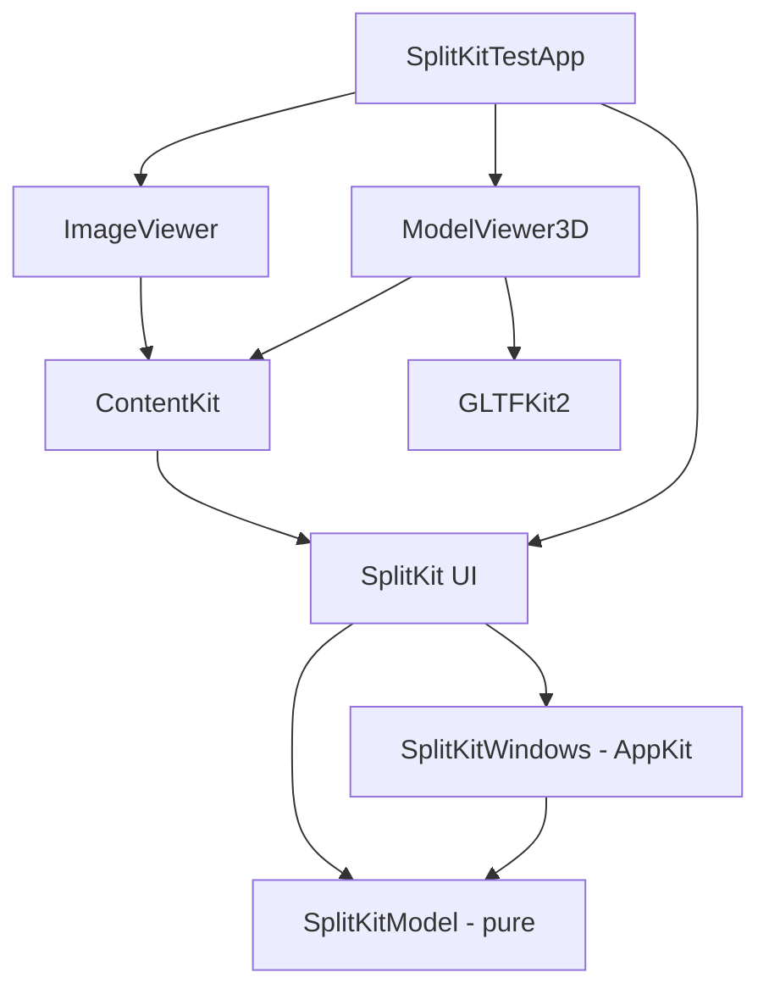

# SplitKit: Phase 0 Specification (APPROVED, 16 Oct 2026)

Status: **Specification only. No code, no repo created.** Replaces the scope of `larevo-phase0-spec.md`, which is kept for reference.
**Goal:** (1) get **SplitKit 100% right**, and (2) validate the spec → prototype process with Grok Bot coordinating Cursor.

---

## 1. Context and environment

- **New repo `SplitKit`**, fully independent of Larevo. Larevo is only the umbrella workflow; it is neither a dependency nor modified.
- Lessons from the earlier Larevo inspection, used as reference only and not copied as dependencies:
  - Larevo's macOS app uses SwiftPM, swift-tools 5.10, macOS 14, CI on macOS 15/Xcode 16.4 and macOS 26/latest Xcode.
  - Its layout is a fixed 1–3 pane enum, with no tree, detach or multi-monitor. Its AppKit divider handle (pointer tracked in window coordinates) is a useful pattern.
- **Platform baseline (decided):**
  - **macOS 26 Tahoe minimum. No legacy support**: no shims, fallbacks or `#available`/`@available` branches. Current APIs are used as-is.
  - **Xcode 27.1** (released 15 Oct 2026, requires macOS 26.6+), **Swift 6.4**, **Swift 6 language mode**, `swift-tools-version: 6.x` in both packages.
  - CI needs a runner image with Xcode 27.1; verify availability when CI is set up.
- **Monitors:** multi-monitor support is required, but Marc can test only on a single MacBook screen. Display logic is therefore a pure, display-abstracted model tested over simulated configurations (§8).

## 2. Repository layout

```
SplitKit/  (repo root)
├─ SplitKit/                 # Swift package: layout engine only, renders no content
│  ├─ Package.swift
│  ├─ Sources/SplitKitModel/     # pure Swift: tree, ops, proportions, persistence, migrations
│  ├─ Sources/SplitKit/          # SwiftUI rendering, headers, dividers, drop targets
│  ├─ Sources/SplitKitWindows/   # AppKit: windows, detach/dock, screen restore (may be folded into SplitKit)
│  └─ Tests/SplitKitModelTests/, Tests/SplitKitTests/
├─ SplitKitViews/           # Swift package: one target/product per content
│  ├─ Package.swift
│  ├─ Sources/ContentKit/        # small shared protocol target (depends on SplitKit's content protocol only)
│  ├─ Sources/ImageViewer/
│  ├─ Sources/ModelViewer3D/     # depends on GLTFKit2
│  └─ Tests/...
├─ SplitKitTestApp/          # plain Xcode project: test app AND integration sample; depends on both packages via local path
├─ docs/                     # ADRs, manual test checklists, results
└─ .github/workflows/ci.yml  # swift build + swift test for both packages on macOS runner
```
Both packages stay separate and extractable: each builds and tests on its own (`swift test`), and neither refers to the app. Dependency direction: `App → SplitKitViews → SplitKit`, and `App → SplitKit`. SplitKit has **no** third-party dependencies and knows nothing about specific content.



## 3. Concepts and behaviour rules

- **App** has one or more windows. A **window** holds one layout tree. A **pane** is a leaf region of the tree that hosts **exactly one content** or is empty.
- **Identity:** a `PaneID` (layout slot) is separate from a `ContentID` (the live content instance) and a `ContentType` (e.g. `image`, `model3d`). Moving content keeps its `ContentID` and state. A content is hosted in **at most one** pane at a time.
- **Adding content:** through the header's content picker, the empty-state "Add" button, the menu (*Pane ▸ Add Content…*), or by dragging content or a file onto a drop target.
- **Closing rules:**
  | Action | Behaviour |
  |---|---|
  | Close a pane (not the last) | The pane is removed, and its sibling takes the space. Single-child splits collapse. The content is disposed (it may veto or confirm through `shouldClose`). |
  | Close the **last pane in a main window** | The window stays open in an **empty state**: a centred "Add Content" button plus *Pane ▸ Add Content…* (⌘N-style shortcut). **The app never quits.** |
  | Close a **detached window** (red button / ⌘W) | Its contents are closed (with the same confirmations). *Window ▸ Dock Back* offers a non-destructive alternative before closing. |
  | Detached window becomes empty (its last pane is dragged out or closed) | The detached window closes automatically. Detached windows have no empty state. |
  | Close the last window | The app keeps running (standard macOS). *File ▸ New Window* or a Dock click opens a window that restores the last layout, or an empty state. |
- **Detach:** drag a header past a **threshold** (proposed 40 pt outside window bounds, with a preview on hover) → a new native `NSWindow` at the drop point. The explicit *Pane ▸ Detach* command does the same.
- **Dock:** drag a detached window's pane header over another window → drop targets (left/right/top/bottom/centre-replace). *Pane ▸ Move to Window ▸ …* is the keyboard and menu alternative.
- **Header (owned by SplitKit):** see §4a for exact contents, §4b for content toolbar items, and §4c for styling.
- **Focus mode (v1):**
  - The header's focus toggle, *Pane ▸ Focus Pane* (shortcut ⌃⌘F proposed, remappable) or Esc/toggle again to exit.
  - Focus is per window, and only one pane can be focused per window. The model stores `focusedPane` alongside the untouched tree, so restoring is exact.
  - Structural operations (split, close, detach, drop) in that window exit focus first.
  - Focus state is persisted.
  - It is distinct from native macOS full screen, and both can be combined.
- **Keyboard/menu alternatives for every drag action:** split right/down, move focus (⌥⌘ arrows), move pane to edge, detach, dock, close, add.

## 4. API sketch (illustrative)

```swift
// SplitKitModel (pure, Sendable, Codable)
public struct PaneID: Hashable, Codable, Sendable { public let raw: UUID }
public struct ContentID: Hashable, Codable, Sendable { public let raw: UUID }
public struct ContentType: Hashable, Codable, Sendable { public let raw: String }
public enum Axis: String, Codable, Sendable { case horizontal, vertical }
public enum DropEdge: String, Codable, Sendable { case left, right, top, bottom, center }

public indirect enum LayoutNode: Codable, Equatable, Sendable {
    case pane(id: PaneID, content: ContentID?)
    case split(id: UUID, axis: Axis, children: [LayoutNode], fractions: [Double]) // >=2 children, fractions sum 1
}
public struct ContentRecord: Codable, Equatable, Sendable {
    public var id: ContentID; public var type: ContentType
    public var state: Data            // content-owned, content-versioned
}
public struct WindowLayout: Codable, Equatable, Sendable {
    public var id: UUID; public var kind: Kind; public var root: LayoutNode?   // nil = empty state (main only)
    public var frame: CGRect; public var screenHint: String?; public var focused: PaneID?
    public var focusMode: PaneID?     // v1: pane filling the window; tree left intact for exact restore
    public enum Kind: String, Codable, Sendable { case main, detached }
}
public enum LayoutOp: Sendable {
    case split(PaneID, Axis, insertBefore: Bool, content: ContentID?)
    case close(PaneID)
    case move(ContentID, to: PaneID, edge: DropEdge)
    case setContent(PaneID, ContentID?)
    case resize(splitID: UUID, fractions: [Double])
}
public func apply(_ op: LayoutOp, to root: LayoutNode?) throws -> LayoutNode?   // pure, fully tested
public func clampFractions(_ f: [Double], total: CGFloat, minimums: [CGFloat]) -> [Double]

public struct SavedSession: Codable, Sendable {
    public static let currentVersion = 1
    public var version: Int; public var windows: [WindowLayout]; public var contents: [ContentRecord]
}
public enum Migrator { public static func migrate(_ json: Data) throws -> SavedSession } // stepwise vN→vN+1; unknown future version → safe default, original file kept

// SplitKit (UI): content contract (PaneToolbarItem is refined in §4b; ContentStore is created via ContentRegistry/SplitKitWorkspace in §4d)
public struct PaneToolbarItem: Identifiable {
    public let id: String; public let title: String; public let systemImage: String
    public var priority: Int; public var isEnabled: Bool; public let action: @MainActor () -> Void
}
@MainActor public protocol PaneContent: AnyObject {                // live instance, owned by ContentStore
    static var type: ContentType { get }
    static var displayName: String { get }
    static var systemImage: String { get }
    static var minimumSize: CGSize { get }
    init(id: ContentID, restoring state: Data?)
    var title: String { get }
    var toolbarItems: [PaneToolbarItem] { get }
    func makeView() -> AnyView
    func encodeState() -> Data
    func shouldClose() async -> Bool
}
@MainActor public final class ContentStore {      // single owner → no duplicate hosting
    public func register<C: PaneContent>(_ type: C.Type, acceptsDrop: [UTType] = [])
    public func create(_ type: ContentType, from url: URL?) -> ContentID
}
@MainActor public final class WorkspaceCoordinator {   // SplitKitWindows
    public var undockThreshold: CGFloat = 40
    public func detach(_ pane: PaneID, to screenPoint: CGPoint?)
    public func dock(_ content: ContentID, into window: UUID, at pane: PaneID, edge: DropEdge)
    public func save() throws; public func restore() throws            // clamps windows onto visible screens
}
```

## 4a. Pane header: exact contents

Left to right, in a single row (default height 28 pt, compact 22 pt):

1. **Drag handle**: a subtle grip glyph. Dragging it rearranges, detaches or docks the pane. Hidden when detach and rearrange are both disabled.
2. **Content icon**: the content type's SF Symbol.
3. **Title + chevron (▾)**: the content's `title`. Clicking the icon or title opens the **content picker** (switch this pane's content, or open/add another), with *Split Right / Split Down / Detach / Move to Window / Close* in the same menu.
4. **Content toolbar area**: items supplied by the content (see §4b), right-aligned and flexible.
5. **Overflow button (⋯)**: appears only when content toolbar items don't fit. It never contains the focus or close buttons.
6. **Focus toggle**: a one-click button directly in the header (`arrow.up.left.and.arrow.down.right` / its inverse when active). It is **never moved into overflow** and is never app-level chrome. It toggles this pane to fill its window, and toggling again restores the exact previous layout.
7. **Close button (×)**: always last.

There is **no maximize button**. Focus is the only fill-the-window affordance; it is temporary and restores the previous layout. An empty pane shows an "Add Content" placeholder instead of a header title, but keeps the handle and close button. The header also shows the active and inactive focus state, a drop-target highlight while something is dragged over it, and a right-click context menu identical to the title menu.

## 4b. Content-supplied toolbar controls

Content can put its own controls **in the pane header**; there is no second toolbar row. It declares items, and **SplitKit renders and lays them out**. Content never gets free drawing access to the chrome, so headers stay consistent and themable.

```swift
public struct PaneToolbarItem: Identifiable {
    public enum Kind {
        case button(action: @MainActor () -> Void)
        case toggle(isOn: Binding<Bool>)
        case menu(items: [PaneToolbarItem])               // nested
        case custom(minWidth: CGFloat, view: AnyView)     // escape hatch, e.g. compact segmented control; always gets an overflow fallback
    }
    public let id: String
    public var title: String                 // used for accessibility, tooltip and overflow menu label
    public var systemImage: String?
    public var kind: Kind
    public var priority: Priority = .normal  // .high stays visible longest; .low collapses first
    public var isEnabled: Bool = true
    public var keyboardShortcut: KeyboardShortcut? = nil   // also exported to the menu (§4d)
}
public protocol PaneContent: AnyObject {
    // ...
    var toolbarItems: [PaneToolbarItem] { get }   // observed; changes re-render the header
}
```

**Overflow rules:**
- Items are laid out by priority and then by declaration order.
- When the width is insufficient, lowest-priority items move into ⋯ first; `custom` items fall back to their title/menu form.
- The title truncates (middle-ellipsis) before `.high` items collapse.
- Below the minimum header width, only the handle, icon, ⋯, focus toggle and × remain, and the title appears in the ⋯ menu.
- All items are VoiceOver-labelled and reachable through the menu bar (*Pane ▸ [Content name] ▸ …*).

**First test:** ImageViewer has no items. ModelViewer3D has *Reset Camera* (high priority, ⌘0).

## 4c. Visual customization and theming

**Where the code lives:**
- All chrome rendering (header, dividers, drop-target overlays, empty state, detached-window chrome) lives in the **`SplitKit` (UI) target**, under `Sources/SplitKit/Chrome/` and `Sources/SplitKit/Styles/`.
- `SplitKitModel` contains **no visual code**.
- Content views style only their own body. SplitKitViews never style the chrome.
- Host-app overrides live in the host app, not in the packages.

**Convention: standard SwiftUI patterns, no custom theming system**
1. **Style protocols** modelled on `ButtonStyle`, each with a `Configuration` struct and a default implementation:
   - `PaneHeaderStyle` gets the title, icon, isFocused, isDragging, isNarrow, and the pre-built `handle`, `toolbar`, `overflow` and `closeButton` views to arrange.
   - `PaneDividerStyle` gets the axis, isDragging, isHovered and thickness.
   - `DropTargetStyle` gets the edge and isActive.
   - `EmptyPaneStyle` gets the add action.
   - These are applied with `.paneHeaderStyle(_:)`, `.paneDividerStyle(_:)`, `.dropTargetStyle(_:)` and `.emptyPaneStyle(_:)`, which propagate through the environment like `.buttonStyle`.
   - Built-in styles:
     - **`.glass` (default)**: macOS 26 Liquid Glass via native SwiftUI APIs, namely `.glassEffect(_:in:)`, `GlassEffectContainer` for grouped header controls, `.buttonStyle(.glass)` for header buttons, and `Material` backgrounds where glass isn't appropriate (e.g. drop-target overlays).
     - `.plain` (no glass, opaque semantic colours).
     - `.compact` (reduced metrics).
   - **No custom component library:** header buttons, menus, pickers and toggles are standard SwiftUI controls styled by the system.
   - Marc may send a Larevo glassmorphism screenshot as a visual reference; the default tokens will be tuned to it.
2. **Design tokens (environment-injected)** for full host customization: `SplitKitTokens`, set with `.splitKitTokens(_:)`, which contains:
   - **metrics**: header height, divider thickness and hit width, corner radius, padding, spacing.
   - **glass**: the glass variant (`.regular`/`.clear`), tint, interactive flag, and the material used for overlays.
   - **colors**: semantic roles (focus ring, drop highlight, divider, header foreground), defaulting to system colours.
   - **motion**: animation curves; Reduce Motion is honoured.

   Tokens are plain values, so a host can replace them wholesale or override single fields (`.splitKitTokens(\.metrics.headerHeight, 24)`). The standard `.tint()`, `.font()` and `.controlSize()` are honoured.
3. **View modifiers** for behaviour-adjacent options, e.g. `.paneHeaderVisibility(.automatic | .hidden)`.

**System appearance:**
- Liquid Glass adapts automatically to light/dark mode, wallpaper and accent colour. Reduce Transparency and Increase Contrast make glass more opaque (system behaviour), with no custom fallback code.
- Defaults use semantic colours only: `.primary`/`.secondary` labels, `Color(nsColor: .separatorColor)`, `.controlAccentColor` / `.tint` for focus and drop highlights, and `.windowBackgroundColor` / materials for chrome.
- Light/dark mode, the user's accent colour, Increase Contrast, Reduce Transparency and Reduce Motion (which disables drag animations) all apply automatically.
- There are no hard-coded colours in default styles. Snapshot tests cover light, dark and increased contrast.

## 4d. Host-app integration

**Required steps:**
1. Add the package(s): SplitKit, plus any SplitKitViews products needed (e.g. only `ModelViewer3D`).
2. Create a registry: `let registry = ContentRegistry()`.
3. Register contents: `registry.register(ImageViewerContent.self, acceptsDrop: [.image])`, `registry.register(ModelViewer3DContent.self, acceptsDrop: [.gltf, .glb])`.
4. Create the workspace: `let workspace = SplitKitWorkspace(registry: registry, configuration: config)`. It owns the `ContentStore` and the `WorkspaceCoordinator`.
5. Choose the hosting mode:
   - **SplitKit-managed windows (default):** `workspace.restoreOrOpenDefault()`. SplitKit creates and manages all main and detached `NSWindow`s.
   - **Host-managed:** embed `SplitKitView(workspace: workspace, window: id)` in your own SwiftUI `WindowGroup` or `NSWindow`. Detached windows are still created by SplitKit unless detach is disabled, or the host supplies a `makeDetachedWindow` callback.
6. Provide persistence: `config.persistence = .file(url)` (default: `Application Support/<bundle id>/SplitKit/session.json`).
7. Optional: add `.commands { SplitKitCommands(workspace) }` to get the standard Pane/Window menus.

```swift
var config = SplitKitConfiguration()
config.windowManagement = .splitKit          // .splitKit | .host
config.persistence      = .file(url)         // .disabled | .file(URL) | .custom(SessionStore)
config.detach           = .enabled           // .enabled | .commandOnly | .disabled
config.undockThreshold  = 40                 // pt outside window bounds
config.minimumPaneSize  = CGSize(width: 160, height: 100)  // per-content minimumSize wins if larger
config.dividerHitWidth  = 8
config.emptyState       = .addButton         // closing last pane never quits
config.focusMode        = .enabled           // header toggle + ⌃⌘F + menu
config.closeConfirmation = .askContent       // content's shouldClose decides
config.autosave         = .onChange(debounce: 1.0)   // .onChange | .manual | .onQuit
public protocol SessionStore { func load() throws -> Data?; func save(_ data: Data) throws }  // e.g. host DB, iCloud
```

**Supported options:**
| Option | Values | Default |
|---|---|---|
| Window management | SplitKit-managed / host-managed | SplitKit |
| Persistence | disabled / file / custom `SessionStore` | file in Application Support |
| Detach | enabled / command-only / disabled | enabled |
| Undock threshold | points | 40 |
| Min pane size | global + per-content | 160×100 |
| Commands | `SplitKitCommands` (menus + shortcuts), or host calls `workspace.perform(.splitRight)` etc. itself | opt-in |
| Header | `.automatic` / `.hidden` per pane; custom `PaneHeaderStyle` | automatic |
| Focus mode | enabled / disabled (header toggle + command) | enabled |

Shortcuts can be remapped through `SplitKitCommands(workspace, shortcuts: .default.with(...))` to avoid conflicts with the host app.

## 5. First test contents (SplitKitViews)

| Content | Scope (first test) | Stack |
|---|---|---|
| **ImageViewer** | Display only: aspect-fit, no zoom/pan/rotate. Opens via picker (file panel) or by dropping an image file. Toolbar: none, or "Open…". | `NSImage` / SwiftUI `Image`. No dependencies. |
| **ModelViewer3D** | **glTF (.gltf) + GLB only; FBX out.** Standard gestures: rotate (drag / one-finger trackpad drag), pan (two-finger scroll or ⇧-drag), zoom (pinch / scroll wheel). Toolbar: **Reset camera**. | **GLTFKit2 → RealityKit, rendered in SwiftUI `RealityView` with `.realityViewCameraControls(.orbit)`** |

**3D stack re-evaluation for macOS 26 (decided baseline)**
- **SceneKit is soft-deprecated** (WWDC25, ["Bring your SceneKit project to RealityKit"](https://developer.apple.com/videos/play/wwdc2025/288/); [Apple docs](https://developer.apple.com/documentation/RealityKit/bringing-your-scenekit-projects-to-realitykit)): it's in maintenance mode, gets no new features and only critical fixes, and Apple advises against it for new projects. That conflicts with the "current APIs only" rule.
- **RealityKit on macOS 26** has everything this viewer needs natively:
  - `RealityView` (SwiftUI-first).
  - Built-in orbit camera controls, `realityViewCameraControls(.orbit)`, which handle standard trackpad and mouse rotate/pan/zoom.
  - `cameraTarget` for orbiting around the model.
  - PBR and image-based lighting, plus post-processing.
- **GLTFKit2** ([warrenm/GLTFKit2](https://github.com/warrenm/GLTFKit2), MIT, active; 2026 releases reimplemented the RealityKit conversion with skeletal animation and fixed macOS 26 issues) loads glTF and GLB and converts them to RealityKit entities. RealityKit can't load glTF itself, so this dependency remains necessary.
- **Recommendation: GLTFKit2 + RealityKit.** It is honest about trade-offs:
  - GLTFKit2's SceneKit converter is older and historically more complete. The RealityKit path is newer, so some material and extension edge cases (e.g. KHR extensions, unusual texture setups) may render differently.
  - Reset camera means re-setting `cameraTarget` and the camera pose; that's a small amount of custom code.
  - Mitigation: Phase 4 runs a sample corpus (Khronos glTF-Sample-Assets subset plus Artifex exports) and documents any visual gaps. If gaps are unacceptable, the decision is revisited explicitly rather than handled with a hidden fallback.
- **SceneKit + GLTFKit2 rejected:** it works today with the least code, but it builds new work on a deprecated framework, against the no-legacy rule.
## 6. Deferred contents (not in first test)

| Content | Candidate | Notes |
|---|---|---|
| Terminal | **SwiftTerm** (MIT) | v1.99.0 released 8 Oct 2026 as a bridge to 2.0, which changes the API, so pin it. `LocalProcessTerminalView` provides a real PTY. |
| Code editor | **CodeEditorUI** ([xibbon](https://github.com/xibbon/CodeEditorUI)) | MIT, ~22★, no releases. iPad-focused: on macOS its editor body is literally a placeholder (`#if os(macOS) Text("This is where the editor goes")`). It wraps Runestone on iOS. **Not usable on macOS as-is.** (`Lakr233/CodeEditorUI` is an unrelated CodeMirror web wrapper from 2022.) |
|  | **Runestone** | MIT and mature on iOS, but macOS only via Catalyst ("not fully tested"). Poor fit for an AppKit app. |
|  | Better macOS candidates | **CodeEditSourceEditor** (MIT, tree-sitter, "not production-ready") or **STTextView** (GPL-3 or commercial, TextKit 2, active). Decide when the editor is scheduled. |
| Browser | `WKWebView` | Native. Low cost. |
| File browser | SwiftUI `List`/`OutlineGroup` + `FileManager` | Native. Low cost. |
| GitHub integration | GitHub REST API | New scope; auth adds cost. |

## 7. Phases

| Phase | Deliverables | Acceptance criteria |
|---|---|---|
| **0 Specify** | This document; answers to §11 | Marc's explicit approval. |
| **1 SplitKit basics** | Focus mode (header toggle, ⌃⌘F, menu, exact restore); default glass style + tokens + style protocols (§4c), `SplitKitConfiguration` (§4d); repo skeleton (2 packages + app + CI); `SplitKitModel` ops; nested renderer; dividers with minimum sizes; saved proportions; header + content picker; empty state; two **dummy contents** (colour swatch, counter with state); save/restore v1 | A 2×2 and a 3-level mixed tree can be built by menu and by drag. Dividers respect minimum sizes. The counter keeps its value after a move. Closing the last pane shows the empty state and the app keeps running. Relaunch restores the layout and proportions. Model test coverage ≥ 90%. CI is green. |
| **2 Detach/dock** | Threshold drag-out → native window; drag back with drop targets; *Detach* / *Move to Window* / *Dock Back* commands; close rules from §3 | The counter keeps its state in both directions. The store asserts that no content is ever hosted twice. Every drag action is reachable by menu and keyboard. Close behaviour matches the table exactly. |
| **3 Multi-window/monitor** | Pure `DisplayPlacement` model (§8) + AppKit adapter; geometry persistence | The simulated-display test matrix passes. Single-screen manual checks pass (see §8). The remaining real multi-monitor risk is documented. |
| **4 First contents** | `ImageViewer`, `ModelViewer3D` (glTF/GLB) as separate products | Each works standalone and inside panes, docked and detached. GLB and glTF (with external .bin and textures) sample files load. Trackpad and mouse rotate/pan/zoom and Reset work. An unsupported file (e.g. FBX) shows a clear error. Consumers can import a single product. |
| **5 Optional spatial** | Spatial effects behind a toggle (focus mode moved to Phase 1) | With effects off the app behaves identically. The model is untouched by presentation. Text stays legible. |

Each phase is built as small Cursor PRs. Grok Bot reviews diffs, runs and reads CI, and reports the exact commands and results. No feature is claimed without a test or manual evidence.

## 8. Test strategy

- **Unit (CI, `swift test`):**
  - Every `LayoutOp`, including edge cases: closing the last pane, collapsing single-child splits, moving onto itself, each `DropEdge`.
  - Fraction normalisation and minimum-size clamping.
  - Identity preservation across ops.
  - Codable round-trip; migration fixtures (v0 → v1, a future-version file → safe default with the original kept); a corrupt-file fallback.
  - The window lifecycle state machine (detach → dock → close detached → close last) with a fake coordinator; screen clamping against synthetic display sets.
- **Styling:** snapshot tests of the header at wide, narrow and minimum widths in light, dark and increased-contrast modes; overflow ordering by priority (unit-tested layout function); a custom-style smoke test.
- **Host integration:** a minimal second example target embeds `SplitKitView` in a host-managed window with persistence disabled, which proves the options compile and work.
- **Integration:** the content store's no-duplicate-hosting assertion; a content's state survives a detach/dock round trip (dummy counter).
- **Manual on a real Mac (checklist in `docs/`, results recorded):**
  - Drag feel and threshold; cross-window docking; VoiceOver and keyboard commands.
  - Trackpad vs mouse in the 3D viewer.
  - **Single screen (Marc's MacBook):** restore after a resolution/scaling change in System Settings; windows dragged partly off-screen; a session file hand-edited to reference a missing display; the Dock and menu bar visible frame respected; full screen + focus.
- **Multi-monitor without a second monitor:**
  - Placement logic is a pure model: `DisplayPlacement.restore(windows:savedDisplays:currentDisplays:) -> [CGRect]` over `struct DisplaySnapshot { id, frame, visibleFrame, scale, isMain }`. It has no `NSScreen` dependency; a thin adapter maps `NSScreen` to `DisplaySnapshot`.
  - Unit tests cover simulated configurations: adding a display; removing the display a window was on; rearranging (left↔right, stacked vertically, negative coordinates); resolution and scale changes; the main display switching; a mixed Retina and non-Retina set; a window spanning two displays; very small displays.
  - The invariant asserted everywhere: every window is ≥ 80% inside some `visibleFrame` and at least its minimum size.
  - **Remaining risk:** the real `NSScreen` and notification behaviour on hot-plug, plus per-display Spaces and full-screen interplay, can't be verified without a second display. It stays flagged until someone tests on real hardware (e.g. an external monitor or Sidecar iPad, if available).

## 9. Risks
1. Cross-window drag and drop in SwiftUI is limited and likely needs AppKit dragging sessions. Spike this first in Phase 2; the fallback is commands first.
2. Live content must survive re-parenting between windows. The `ContentStore` owns instances, and views are re-attached rather than recreated.
3. Screen identity across reconnects is unreliable, so restore uses clamping rather than exact matching.
4. GLTFKit2's RealityKit converter may show material gaps versus its SceneKit path; this is checked with a sample corpus in Phase 4.
5. Multi-monitor is verified only in simulation (see §8).
6. CI runner availability for Xcode 27.1 / macOS 26.6.
7. Cursor usage is currently exhausted, which blocks the build until on-demand usage is enabled.

## 10. Process validation (Larevo question, filled in at the end)
| Question | Evidence | Verdict |
|---|---|---|
| How far did Grok Bot + Cursor get from spec to working prototype without hand-coding? | _tbd_ | _tbd_ |
| Where did the process need human help (reviews, manual tests, fixes)? | _tbd_ | _tbd_ |
| Is local-model support still a differentiator for Larevo? | _tbd_ | _tbd_ |
| What would a dedicated Larevo app add (context, continuity, control)? Build, narrow or drop? | _tbd_ | _tbd_ |

## 11. Open questions (undecided only)
1. **Repo licence and visibility:** for example MIT and public, or private and unlicensed.

*Decided and removed from this list: macOS 26 minimum, Xcode 27.1 / Swift 6.4 / Swift 6 mode, a plain Xcode project app, single-screen testing plus simulation, focus mode in v1, and glass default styling.*


## Visual reference
Larevo glassmorphism screenshot (Oct 16, 2026): `assets/larevo-glass-reference.png` (a style reference, not something to clone). Dark translucent panels with soft gradient tints, rounded cards, a compact top bar with small pill status chips, and a split chat/activity layout with thin dividers. Use it as the style target for the default Liquid Glass tokens.

## Final decisions (16 Oct 2026)
- Repo: public GitHub `SplitKit`, MIT licence.
- Licence and visibility are no longer open questions. The spec is approved and coding may start.
