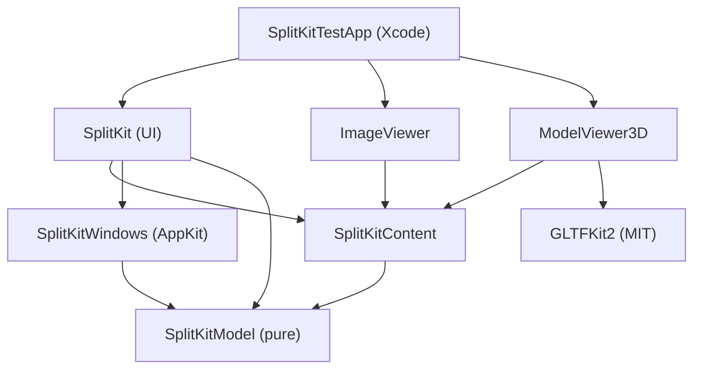

# SplitKit: Phase 0 Specification

**Status: Approved — Revision 3 (16 Oct 2026), ready for Phase 1.**
Revision 1 was approved on 16 Oct 2026. Revisions 2 and 3 resolve two external reviews that Marc accepted. Implementation starts with Phase 1 (§11).

**Goal:** (1) get **SplitKit 100% right**, and (2) validate the spec → prototype process (Grok Bot coordinating Claude).

---

## Revision 3 changelog

1. `pendingCloses` moved out of the Codable `Session` into runtime-only `WorkspaceRuntime` state (§5, §6.3).
2. **Unknown-content recovery** is an explicit `.unavailable` pane placeholder. It keeps the `ContentID`, `ContentType` and serialized state, but nothing is hosted. It offers **Restore** when the registry gains the type and restores automatically on relaunch. It is distinct from genuinely orphaned records, which are dropped (§5, §8).
3. **Concrete toolchain:** `// swift-tools-version: 6.2` in both manifests, built with Xcode 27.1 / Swift 6.4 in Swift 6 language mode. CI is pinned to the same Xcode (§1).
4. **3D camera contract** replaces the fixed `.realityViewCameraControls(.orbit)` call: orbit, independent pan, zoom/dolly, reset (pose + target), and a verified mouse/trackpad mapping. Phase 1 Spike B decides between native control modes and custom gestures (§10).
5. **Atomic save:** the first save creates the file by writing a temp file and moving it into place. Later saves use `replaceItemAt`. A failed write always preserves the previous valid session (§8).
6. **Failed transactions leave the whole observable app state unchanged** (ownership, windows, pending close, lifecycle callbacks), with new integration tests (§6.2, §13).
7. **Self-drop is always a no-op** (every edge and centre). Edge of a different pane = move + split; centre of a different pane = swap, or a move if it's empty. A cross-window dock applies the same semantics atomically across both trees (§6.2).
8. Added a manual usability check for ⌘W / ⇧⌘W / last pane / detached window, with menu labels and prompts (§7.5, §13).
9. The two Phase 1 spikes are explicit **go/no-go gates** (§11). The traceability checklist was updated (§13.1).

## Revision 2 changelog

1. **Package graph fixed (no cycle).** There is a new UI-neutral target and product, `SplitKitContent`, in the SplitKit package. It holds the content contract. The SplitKit UI and every SplitKitViews product depend on it. `ContentKit` is removed. The diagram and text are updated (§3).
2. **One canonical API section (§5).** Every public type appears once, with its owning target. Duplicate `PaneToolbarItem`/`PaneContent` declarations are gone. `ContentRegistry` is fully defined (registration, duplicates, unknown types, errors).
3. **Layout operations are transactions (§6)**, each with preconditions, result, content ownership and failure cases. **Decision: a centre drop swaps** the two contents. Same-axis splits are flattened. Invalid operations throw; there are no silent repairs.
4. **Tree invariants (§6.1):** flattening, fraction rules (NaN/zero/negative rejected), point units, a window smaller than the sum of minimum sizes, and empty pane vs `root == nil`.
5. **Two-stage close (§6.3):** an async `shouldClose` that never mutates the tree, then commit and release. Defines what happens to concurrent operations on a pending pane.
6. **Persistence hardened (§8):** session invariants, validation before restore, the original file kept on recovery, atomic writes, defined snapshot points, and a consistent layout+content snapshot.
7. **State ownership (§6.4)** split into content object, SwiftUI view-local and serialisable state, and proven with a counter test.
8. **Focus model (§7.3):** two explicit fields, `activePane` (keyboard/selection) and `focusModePane` (fill-window). Behaviour on resize, display change, native full screen and persistence is defined.
9. **Windows (§9):** deterministic placement fallback (reachability wins; size is clamped). The saved frame, actual frame and re-persisted frame are kept separate to prevent drift. Window ownership is defined for SplitKit-managed and host-managed modes.
10. **Theming scoped down:** `.glass` and `.plain` ship first; `.compact` is later. A small, stable token set. Custom toolbar views are optional in milestone 1, and the macOS 26 glass APIs and accessibility are verified with a small example (§7.2).
11. **Phases reordered (§11):** P1 model + feasibility spikes (cross-window live-content transfer, RealityKit/GLTFKit2), P2 usable split UI, P3 detach/dock/displays, P4 real contents, P5 optional spatial.
12. **3D spike and corpus** with required vs optional glTF features and measurable criteria (§10). Added a public error model, a default shortcut table with collision tests, per-product clean consumer tests, a traceability matrix and reporting rules (§12–13).

---

## 1. Decisions in force

| Area | Decision |
|---|---|
| Repo | Public GitHub `mdidillon/SplitKit`, **MIT**. Independent of Larevo, which is not a dependency and is not modified. |
| Platform | **macOS 26 Tahoe minimum.** No legacy support: no shims, fallbacks or availability branches. |
| Toolchain | **Xcode 27.1**, Swift 6.4, **Swift 6 language mode**, manifests declare **`// swift-tools-version: 6.2`** literally in both packages. That is the newest tools version we treat as confirmed; 6.4 was not verifiable from public sources, so it is used only if Spike checks show Xcode 27.1 accepts it, via a deviation report. CI uses **the same Xcode 27.1 (Swift 6.4)** on a macOS 26.6+ runner, selected explicitly with `xcode-select`, and the build fails if a different Xcode is active. |
| Structure | `SplitKit/` and `SplitKitViews/` are separate, extractable Swift packages. `SplitKitTestApp/` is a plain **Xcode project**, used as both the test app and the integration sample. |
| Views | One product per content view. First contents: **ImageViewer** (display only) and **ModelViewer3D** (glTF/GLB via **GLTFKit2 + RealityKit**; FBX out). |
| Header | SplitKit owns it. **Focus toggle in the header**, no maximize button. |
| Look | **Liquid Glass default** using native SwiftUI glass APIs and materials, plus environment design tokens. The Larevo screenshot (`assets/larevo-glass-reference.png`) is a **reference, not a clone**. |
| Lifecycle | Closing the last pane never quits the app (empty state with an Add button and a menu command). |
| Monitors | Required. Marc tests on a single MacBook screen, so placement is a pure model tested over simulated displays (§9). |

## 2. Repository layout

```text
SplitKit/                        (repo root)
├─ SplitKit/                     Swift package — layout engine, renders no content
│  ├─ Package.swift
│  ├─ Sources/SplitKitModel/     pure Swift (Foundation only): IDs, tree, transactions, persistence, migrations, DisplayPlacement
│  ├─ Sources/SplitKitContent/   content contract: PaneContent, PaneToolbarItem, ContentRegistry (no dependency on SplitKit UI)
│  ├─ Sources/SplitKitWindows/   AppKit: window coordinator, detach/dock sessions, NSScreen → DisplaySnapshot adapter
│  ├─ Sources/SplitKit/          SwiftUI: workspace view, chrome (Chrome/), styles and tokens (Styles/), commands
│  └─ Tests/                     SplitKitModelTests, SplitKitContentTests, SplitKitWindowsTests, SplitKitTests
├─ SplitKitViews/                Swift package — one product per content
│  ├─ Package.swift
│  ├─ Sources/ImageViewer/
│  ├─ Sources/ModelViewer3D/     depends on GLTFKit2
│  └─ Tests/
├─ SplitKitTestApp/              Xcode project: test app + integration sample (local package references)
├─ Docs/                         spec, ADRs, traceability matrix, manual checklists and results, assets/
└─ .github/workflows/ci.yml
```

**SplitKit package products:** `SplitKitModel`, `SplitKitContent`, `SplitKit` (the UI, which includes Windows). **SplitKitViews products:** `ImageViewer`, `ModelViewer3D`.

## 3. Dependency graph

`SplitKitContent` imports Foundation, SwiftUI (only for the `View` and `KeyboardShortcut` types) and `SplitKitModel`. It **never imports the SplitKit UI target**, so content products and the engine UI both depend on the contract and not on each other.



Rules: arrows point at dependencies. No target in `SplitKit/` depends on `SplitKitViews/`. A content product never depends on `SplitKit` (UI). Only the host app links both.

## 4. Concepts

- **Window:** holds one layout tree; its kind is `main` or `detached`.
- **Pane:** a leaf of the tree. It hosts **one content or none** (an empty pane).
- **Content:** a live `PaneContent` object, identified by `ContentID`, with a `ContentType` (e.g. `"image"`). It is owned by the `ContentStore` and hosted in **at most one pane** at a time.
- **Identity:** `PaneID` (the slot), `ContentID` (the instance) and `ContentType` (the kind) are independent. Moving content keeps its `ContentID` and state.
- **Units:** all geometry is in **points** (AppKit/SwiftUI coordinate space). Display scale only matters for snapshot metadata.

## 5. Canonical public API

> **Illustrative Swift, not final code.** This is the *only* place public types are declared; other sections refer to them by name. Signatures may change during implementation only through a deviation report (§13).

```swift
// ───────────── Target: SplitKitModel (Foundation only, all Sendable) ─────────────
public struct PaneID: Hashable, Codable, Sendable { public let raw: UUID }
public struct SplitID: Hashable, Codable, Sendable { public let raw: UUID }
public struct WindowID: Hashable, Codable, Sendable { public let raw: UUID }
public struct ContentID: Hashable, Codable, Sendable { public let raw: UUID }
public struct ContentType: Hashable, Codable, Sendable { public let raw: String }   // reverse-DNS, e.g. "splitkit.image"
public enum Axis: String, Codable, Sendable { case horizontal, vertical }
public enum DropEdge: String, Codable, Sendable { case left, right, top, bottom, center }

public indirect enum LayoutNode: Codable, Equatable, Sendable {
    case pane(id: PaneID, content: ContentID?)
    case split(id: SplitID, axis: Axis, children: [LayoutNode], fractions: [Double])
}

public struct WindowLayout: Codable, Equatable, Sendable {
    public enum Kind: String, Codable, Sendable { case main, detached }
    public var id: WindowID
    public var kind: Kind
    public var root: LayoutNode?          // nil only for .main = empty state
    public var activePane: PaneID?        // keyboard/selection focus
    public var focusModePane: PaneID?     // pane filling the window; tree untouched
    public var placement: SavedPlacement  // see §9
}

public enum LayoutTransaction: Sendable {
    case insert(ContentID?, at: PaneID, edge: DropEdge, in: WindowID)   // edge ≠ .center: split; .center: into empty pane only
    case move(ContentID, to: PaneID, edge: DropEdge, in: WindowID)      // .center = swap (§6.2)
    case reorder(splitID: SplitID, from: Int, to: Int)
    case resize(splitID: SplitID, fractions: [Double])
    case beginClose(PaneID)                                             // stage 1, see §6.3
    case commitClose(PaneID)                                            // stage 2
    case cancelClose(PaneID)
    case setFocusMode(PaneID?, in: WindowID)
    case setActive(PaneID?, in: WindowID)
    case detach(PaneID, to: WindowID /* new */, placement: SavedPlacement)
}

public struct Session: Codable, Equatable, Sendable {
    public static let currentVersion = 1
    public var version: Int
    public var windows: [WindowLayout]
    public var contents: [ContentRecord]
}
public struct ContentRecord: Codable, Equatable, Sendable {
    public var id: ContentID; public var type: ContentType
    public var stateVersion: Int; public var state: Data
    public var availability: Availability = .hosted
    public enum Availability: String, Codable, Sendable {
        case hosted        // a live object exists (or will on restore)
        case unavailable   // type not registered: shown as a recoverable placeholder, never hosted, data retained verbatim
    }
}

public enum SessionEngine {
    /// Pure. Returns the new session or throws; never repairs silently.
    public static func apply(_ t: LayoutTransaction, to s: Session, runtime: WorkspaceRuntime) throws(LayoutError) -> TransactionResult
    public static func validate(_ s: Session) -> [InvariantViolation]          // empty = valid
}
public struct TransactionResult: Sendable {
    public var session: Session
    public var runtime: WorkspaceRuntime
    public var windowsCreated: [WindowID]      // the coordinator acts on these only after success
    public var windowsClosed: [WindowID]
    public var released: [ContentID]          // contents whose host must dispose them
    public var normalizations: [Normalization] // documented, e.g. .flattened(SplitID), .collapsed(SplitID)
}

/// Runtime-only state: never encoded, never part of `Session` equality.
public struct WorkspaceRuntime: Sendable {
    public var pendingCloses: Set<PaneID> = []
    public var activeDrag: DragSessionID? = nil
}

public enum Migrator {
    public static func decode(_ data: Data) throws(PersistenceError) -> Session  // stepwise vN→vN+1, then validate
}

public struct DisplaySnapshot: Equatable, Sendable { public var id: String; public var frame, visibleFrame: CGRect; public var scale: Double; public var isMain: Bool }
public struct SavedPlacement: Codable, Equatable, Sendable {
    public var intendedFrame: CGRect          // last frame the USER set
    public var displayID: String?             // hint only
    public var relativeOrigin: CGPoint?       // origin relative to that display's visibleFrame
}
public enum DisplayPlacement {
    public static func resolve(_ p: SavedPlacement, minSize: CGSize, displays: [DisplaySnapshot]) -> CGRect // pure, §9
}

// Errors (§12)
public enum LayoutError: Error, Equatable, Sendable {
    case unknownPane(PaneID), unknownSplit(SplitID), unknownWindow(WindowID), unknownContent(ContentID)
    case contentAlreadyHosted(ContentID), centerInsertIntoOccupiedPane
    case invalidFractions(reason: String), indexOutOfRange
    case paneClosePending(PaneID), noCloseInProgress(PaneID)
    case wouldEmptyDetachedWindowIllegally
}
public enum PersistenceError: Error, Sendable {
    case unreadable(underlying: String), unsupportedFutureVersion(Int), migrationFailed(from: Int, reason: String)
    case invalid([InvariantViolation])
}
public enum InvariantViolation: Equatable, Sendable { /* duplicateContentID, missingContentRecord, orphanRecord(dropped), badFractions, singleChildSplit, sameAxisNesting, unknownType(ContentType), emptyDetachedWindow, danglingFocus, … */ }

// ───────────── Target: SplitKitContent (Foundation, SwiftUI types, SplitKitModel) ─────────────
@MainActor public protocol PaneContent: AnyObject, Observable {
    static var type: ContentType { get }
    static var displayName: String { get }
    static var systemImage: String { get }
    static var minimumSize: CGSize { get }                   // points
    static var stateVersion: Int { get }
    init(id: ContentID, restoring state: Data?, stateVersion: Int?) throws(ContentError)
    var title: String { get }
    var toolbarItems: [PaneToolbarItem] { get }              // observed; changes re-render the header
    func makeView() -> AnyView                               // may be called again after re-hosting
    func encodeState() throws -> Data
    func shouldClose() async -> Bool                         // must not touch the layout
    func willRelease()                                       // after commit; tear down resources
}

public struct PaneToolbarItem: Identifiable {
    public enum Kind {
        case button(action: @MainActor () -> Void)
        case toggle(isOn: Binding<Bool>)
        case menu(items: [PaneToolbarItem])
        case custom(minWidth: CGFloat, view: AnyView)        // optional in milestone 1; requires title + fallback action
    }
    public enum Priority: Int, Comparable { case low, normal, high }
    public let id: String
    public var title: String                                 // required: accessibility label, tooltip, overflow label
    public var systemImage: String?
    public var kind: Kind
    public var priority: Priority = .normal
    public var isEnabled: Bool = true
    public var keyboardShortcut: KeyboardShortcut? = nil
    public var fallbackAction: (@MainActor () -> Void)? = nil // used when .custom collapses into overflow
}

public enum ContentError: Error, Sendable {
    case unsupportedFile(URL, reason: String), unreadable(URL), stateIncompatible(version: Int), other(String)
}

@MainActor public final class ContentRegistry {
    public init()
    public func register<C: PaneContent>(_ type: C.Type, accepts: [UTType] = []) throws(RegistryError)
    public var registeredTypes: [ContentType] { get }
    public func type(for url: URL) -> ContentType?           // first registered match wins; deterministic order
    public func make(_ type: ContentType, id: ContentID, url: URL?, state: Data?, stateVersion: Int?) throws(RegistryError) -> any PaneContent
}
public enum RegistryError: Error, Sendable {
    case duplicateType(ContentType)                          // registering the same type twice → thrown, first stays
    case unknownType(ContentType)                            // make() for an unregistered type
    case creationFailed(ContentType, ContentError)
}

// ───────────── Target: SplitKitWindows (AppKit, SplitKitModel) ─────────────
@MainActor public final class WindowCoordinator { /* owns NSWindows in .splitKit mode; drag sessions; screen adapter */ }

// ───────────── Target: SplitKit (SwiftUI; depends on all above) ─────────────
@MainActor @Observable public final class SplitKitWorkspace {
    public init(registry: ContentRegistry, configuration: SplitKitConfiguration) throws(PersistenceError)
    public func restoreOrOpenDefault() -> RestoreReport                      // .splitKit mode
    public func perform(_ command: SplitKitCommand) async throws(LayoutError)
    public func addContent(_ type: ContentType, url: URL?, into: PaneID?) async throws(RegistryError)
    public func restoreUnavailable(_ id: ContentID) throws(RegistryError)    // placeholder ▸ Restore
    public private(set) var runtime: WorkspaceRuntime
    public func saveNow() async throws(PersistenceError)
    public var lastSaveError: PersistenceError? { get }
}
public struct SplitKitView: View { public init(workspace: SplitKitWorkspace, window: WindowID) }   // .host mode
public struct SplitKitCommands: Commands { public init(_ ws: SplitKitWorkspace, shortcuts: ShortcutMap = .default) }

public struct SplitKitConfiguration: Sendable {
    public enum WindowManagement: Sendable { case splitKit, host(makeDetachedWindow: (@MainActor (WindowID) -> NSWindow)?) }
    public enum Persistence: Sendable { case disabled, file(URL), custom(any SessionStore) }
    public enum Detach: Sendable { case enabled, commandOnly, disabled }
    public var windowManagement: WindowManagement = .splitKit
    public var persistence: Persistence = .file(.applicationSupportDefault) // App Support/<bundle id>/SplitKit/session.json
    public var detach: Detach = .enabled
    public var undockThreshold: CGFloat = 40                 // pt beyond window bounds
    public var minimumPaneSize = CGSize(width: 160, height: 100)  // per-content minimumSize wins if larger
    public var dividerHitWidth: CGFloat = 8
    public var focusModeEnabled = true
    public var autosaveDebounce: Duration = .seconds(1)
}
public protocol SessionStore: Sendable {
    func load() async throws -> Data?
    func save(_ data: Data) async throws                     // must be atomic for its medium
}

// Styling (SplitKit/Styles)
public protocol PaneHeaderStyle { associatedtype Body: View; func makeBody(configuration: PaneHeaderConfiguration) -> Body }
public protocol PaneDividerStyle { associatedtype Body: View; func makeBody(configuration: PaneDividerConfiguration) -> Body }
public protocol EmptyPaneStyle  { associatedtype Body: View; func makeBody(configuration: EmptyPaneConfiguration) -> Body }
public struct SplitKitTokens: Sendable { public var metrics: Metrics; public var glass: Glass; public var colors: Colors /* §7.2 */ }
// Modifiers: .paneHeaderStyle(_:) .paneDividerStyle(_:) .emptyPaneStyle(_:) .splitKitTokens(_:)
```

## 6. Layout model

### 6.1 Tree invariants (checked by `SessionEngine.validate` after every transaction and on load)

1. Every `split` has **≥ 2 children** and `fractions.count == children.count`.
2. **Same-axis flattening:** a child split never has the same axis as its parent. It is merged into the parent, and its fractions are multiplied by the parent fraction. Transactions return `.flattened(SplitID)` in `normalizations`. On load, a same-axis nesting is a violation (§8), not a silent fix.
3. **Fractions:** every value is finite and `> 0`, and the sum is `1 ± 1e-9`. `resize` with NaN, ∞, ≤ 0 or the wrong count **throws `invalidFractions`**. A valid but un-normalised sum (e.g. 2:1) is normalised and reported as `.normalizedFractions`.
4. **Minimum sizes are not stored in fractions.** At render time, a pane's size is `max(fraction × available, min)` and is compressed proportionally when `available < Σ mins`. Stored fractions are **never rewritten** by layout passes. The window's `contentMinSize` is set to the tree's Σ mins plus chrome, so this case only happens when the system forces a window smaller (e.g. a tiny display).
5. **Ownership:** each `ContentID` appears in at most one pane across **all windows**. Every hosted ID has a `ContentRecord` or a live object.
6. **Empty states:** `root == nil` is allowed only for `.main` windows (the empty state with an Add button). `.pane(content: nil)` is an **empty pane** with a placeholder, allowed anywhere except as the sole root of a detached window. A detached window whose last content leaves is closed (§6.3).
7. `activePane` and `focusModePane` refer to existing panes in that window, or are nil.

### 6.2 Transactions

| Transaction | Preconditions | Result | Content ownership | Failure cases |
|---|---|---|---|---|
| **Edge insert** (`insert`, edge ≠ center) | Target pane exists; content is not hosted | The target becomes a split (or joins the parent split if it's the same axis, with flattening) and the new pane gets half the target's fraction | The new content is hosted; nothing is released | `unknownPane`, `contentAlreadyHosted` |
| **Center insert** | Target pane is **empty** | The content goes into the empty pane | Hosted | `centerInsertIntoOccupiedPane` (to replace, use the content picker: insert new, then a two-stage close of the old) |
| **Self-drop** (`move` with T == S, any edge **or** centre) | none | **Always a no-op**: the unchanged session, no normalisations, no callbacks, no snapshot | Unchanged | none (not an error) |
| **Edge move** (`move`, edge ≠ center) | Content hosted in source pane S ≠ target T | S is removed (collapse/flatten), then an edge insert at T (move + split) | Same `ContentID`; no release | `unknownContent`, `paneClosePending` |
| **Center move = swap** | S ≠ T; both exist | If T has content, **S and T exchange contents**. If T is empty, the content moves and S becomes empty (an empty S in a detached window that would leave it with no content → the window closes after commit) | Both IDs keep their state; **nothing is released or closed** | `paneClosePending` (self is handled by the self-drop row) |
| **Reorder** | Valid split and indices | Children and fractions are permuted together | Unchanged | `indexOutOfRange` |
| **Resize** | Valid split and fractions (§6.1.3) | Fractions are replaced | Unchanged | `invalidFractions` |
| **Detach** | Pane exists, detach is enabled | The pane is removed from its window (collapse); a new `.detached` window holds `.pane(newPaneID, sameContent)` | Same `ContentID` | `paneClosePending`; detaching the only pane of a main window is allowed (the main window shows its empty state) |
| **Dock** (cross-window move) | S in window A, T in window B | **Exactly the same semantics as a move** (edge = move + split, centre = swap or move into empty), applied **atomically across both trees in one transaction**. If A is detached and becomes empty, it's listed in `windowsClosed` | Same `ContentID` | As for move; on failure neither tree changes |

**Why swap for a centre drop:** it's the only centre behaviour that is **lossless and synchronous**. It never needs a `shouldClose` confirmation in the middle of a drag, never destroys state by accident, and is undone by dropping again. Replacing content stays an explicit, confirmable action in the content picker. Rejecting the drop entirely would make the centre target useless.

Every transaction is **all-or-nothing**. On throw, the **entire observable app state is unchanged**:
- the `Session` (byte-identical when encoded) and the `WorkspaceRuntime`, including pending closes;
- content ownership: no content is created, released or re-hosted, and no `willRelease()`/`shouldClose()` is called;
- windows: no `NSWindow` is created, shown, moved or closed. The coordinator applies `windowsCreated`/`windowsClosed` only after a successful result;
- no snapshot or autosave is triggered.

The engine computes everything purely first; side effects happen only after success, in a fixed order (create windows → re-host → release → close windows → snapshot). The model never "fixes" bad input; it either throws or returns a documented normalisation.

### 6.3 Two-stage close

1. `beginClose(P)` marks P **pending** (it's in `WorkspaceRuntime.pendingCloses`, which is runtime-only and never persisted; the tree is unchanged; the header shows a subtle "closing" state). SplitKit then calls `await content.shouldClose()`. The content may show a sheet; it must not mutate the layout.
2. **Accepted →** `commitClose(P)`: the pane is removed (collapse/flatten), and `released = [contentID]`. The host calls `willRelease()`, then drops the object, and a snapshot is taken.
   **Declined →** `cancelClose(P)`: the pending flag is cleared, and **everything else is untouched**.
3. **While pending:** any transaction that touches P (move, swap, detach, a resize of its parent, a second close) throws `paneClosePending`. UI drags from P are disabled. Transactions elsewhere proceed normally, because P's `PaneID` is stable.
4. **Closing a window with N contents:** SplitKit asks each content in tree order. If **any declines, nothing is closed**. If all accept, everything is committed in one transaction.
5. **Last pane of a main window** → `root = nil` (empty state); the app stays alive. **Last content of a detached window** → the window closes. Closing the last window keeps the app running; *File ▸ New Window* restores or opens the empty state.

### 6.4 State ownership

| Kind | Lives in | Survives move/detach/dock | Persisted |
|---|---|---|---|
| **Content state** (document URL, camera pose, counter value) | The `PaneContent` object (owned by `ContentStore`) | Yes, because the object is never recreated | Yes, via `encodeState()` with a `stateVersion` |
| **View-local** (hover, transient animation, scroll inertia) | SwiftUI `@State` inside `makeView()` | **No**: the view may be rebuilt when re-hosted. Documented as acceptable. | No |
| **Layout state** (tree, fractions, active/focus pane, placement) | `Session` (SplitKitModel) | Yes | Yes |

**Proof test (Phase 1 spike, Phase 3 regression):** a `CounterContent` keeps its count in the object and a "view-local taps" count in `@State`. After split → move → swap → detach → dock → relaunch, the object count is preserved at every step and after relaunch. The view-local count may reset, and the test asserts it is documented rather than relied on. A debug assertion and a unit test check that `makeView()` hosting never exists for one `ContentID` in two windows at the same time.

## 7. Pane chrome

### 7.1 Header contents (left → right, one row, default 28 pt)

1. **Drag handle** (grip). Hidden if both rearrange and detach are disabled.
2. **Content icon** (SF Symbol of the type).
3. **Title + ▾**: opens the **content picker / pane menu** (switch content, Add, Split Right, Split Down, Detach, Move to Window ▸, Close).
4. **Content toolbar items** (§7.4), right-aligned and flexible.
5. **Overflow ⋯**: only when content items don't fit. It never holds focus or close.
6. **Focus toggle**: one click, always visible, never in overflow. It enters and exits focus mode for this pane.
7. **Close ×**: always last.

There's no maximize button. An empty pane shows "Add Content" in place of the title and keeps the handle, focus and close. The header also shows active/inactive state, a drop highlight and a pending-close state. Right-click opens the same pane menu.

### 7.2 Theming

- **Code location:** all chrome lives in `SplitKit/Sources/SplitKit/Chrome/` and `Styles/`. `SplitKitModel`, `SplitKitContent` and the content products contain no chrome styling. Host overrides live in the host.
- **Convention (standard SwiftUI):** style protocols that behave like `ButtonStyle` (§5), applied through modifiers that propagate in the environment, plus environment-injected `SplitKitTokens`. Header controls are standard SwiftUI `Button`/`Menu`/`Toggle`; there is no custom component library.
- **Milestone 1 styles:** **`.glass` (default)** uses `glassEffect(_:in:)`, `GlassEffectContainer` and `.buttonStyle(.glass)`, with `Material` for drop overlays. **`.plain`** uses opaque semantic colours. **`.compact` is deferred** to after Phase 3.
- **Stable token set (v1, kept small on purpose):**
  - `metrics.headerHeight`, `metrics.dividerThickness`, `metrics.dividerHitWidth`, `metrics.cornerRadius`, `metrics.contentPadding`
  - `glass.variant` (`.regular`/`.clear`), `glass.tint: Color?`
  - `colors.activeIndicator`, `colors.dropHighlight` (default to accent/tint)

  Any additions are reviewed as API changes.
- **System appearance:** semantic colours only. Light/dark, the accent colour, Increase Contrast, Reduce Transparency and Reduce Motion are honoured through system behaviour, with no custom fallback code.
- **Verification (Phase 2 entry):** a small example screen confirms the exact macOS 26 SDK glass APIs and their behaviour under Reduce Transparency, Increase Contrast and VoiceOver before chrome is built. Any API difference gets a deviation report.
- **Visual reference:** `assets/larevo-glass-reference.png` shows dark translucent panels, soft gradient tints, rounded cards, compact pill chips and thin dividers. It is used to tune default tokens. **It is a reference, not a clone.**

### 7.3 Focus model

- **`activePane`** is the keyboard and selection focus: the pane whose content holds the first responder, highlighted in its header. It is set by click and ⌥⌘-arrows.
- **`focusModePane`** is the pane filling its window (focus mode). Entering it also sets `activePane` to that pane.
- **Resize:** no effect on either field. **Display change / re-placement:** unchanged. **Native full screen:** independent and combinable; exiting full screen keeps focus mode. **Structural transactions** in that window (insert, move, detach, close) clear `focusModePane` first. A close of the focused pane clears both fields, and `activePane` moves to the nearest sibling.
- **Persistence:** both fields are persisted. Any dangling reference is set to nil on load (a reported `danglingFocus` normalisation).
- **Commands:** header toggle, *Pane ▸ Focus Pane* (⌃⌘F) and Esc to exit (only when the content doesn't consume Esc).

### 7.4 Content toolbar contract

- Content declares `toolbarItems` (§5), and **SplitKit lays them out**. Content never draws free-form into the chrome.
- **Layout:** by priority, then declaration order. Low priority overflows first, the title truncates (middle) before `.high` items collapse, and at minimum width only the handle, icon, ⋯, focus and × remain.
- **Overflow:** `.button`/`.toggle`/`.menu` become menu items. `.custom` (optional in milestone 1) becomes a menu item using `title` + `fallbackAction`; a `.custom` without a fallback is disabled in overflow.
- **Accessibility:** `title` is required and is the VoiceOver label. Custom views must expose one accessibility element. Every item is also reachable under *Pane ▸ ‹Content name› ▸* in the menu bar.
- **First contents:** ImageViewer has none. ModelViewer3D has *Reset Camera* (`.high`, ⌘0 while the pane is active).

### 7.5 Default shortcuts (remappable via `ShortcutMap`)

| Command | Shortcut |
|---|---|
| Add Content… | ⇧⌘N |
| Split Right / Split Down | ⌘D / ⇧⌘D |
| Move active pane focus | ⌥⌘ ← → ↑ ↓ |
| Move pane to edge | ⌃⌥⌘ ← → ↑ ↓ |
| Focus Pane (toggle) | ⌃⌘F |
| Detach Pane | ⌥⌘D |
| Close Pane | ⌘W (closes the pane; the window closes only when it has no panes) |
| Close Window | ⇧⌘W |

**Close semantics and labels:**
- **⌘W, *Pane ▸ Close Pane*:** closes the active pane.
  - In a detached window with one pane, the menu label reads *Close Pane and Window*.
  - On the last pane of a main window, it reads *Close Pane* and leaves the empty state.
- **⇧⌘W, *Window ▸ Close Window*:** closes the whole window.
  - If 2 or more contents ask to confirm, one prompt lists them: "Close window with N panes?" with *Close All* and *Cancel* buttons.
  - A detached window prompt also offers *Dock Back Instead*.
- **⌘W in an empty main window** closes the window. The app stays alive.

**Collision testing:** a unit test asserts there are no duplicates inside `ShortcutMap.default` or against the standard macOS menu shortcuts SplitKit doesn't own. A host-supplied map is validated at startup; conflicts are reported (as a recoverable error) and not silently overridden. Content shortcuts are only active while their pane is active, and a conflict with a SplitKit shortcut makes the content's shortcut lose, with a debug warning.

## 8. Persistence

- **Format:** JSON `Session` with `version`. `Migrator` applies stepwise migrations and then `validate`.
- **Validation before restore:** duplicate `ContentID`, a hosted ID without a record, an unknown `ContentType`, bad fractions, single-child splits, same-axis nesting, an empty detached window, dangling focus.
  - **Fatal for the file** (e.g. duplicate IDs, bad fractions, structure): restore **does not proceed** with a partially repaired tree. SplitKit opens the default layout, **keeps the original as `session.invalid-<timestamp>.json`**, and returns `RestoreReport` with the violations.
  - **Recoverable: unavailable content.** A pane that references a record whose `ContentType` isn't registered keeps its `ContentID` and becomes an **unavailable placeholder**. The record is marked `.unavailable` and its `type`, `stateVersion` and `state` are kept **verbatim**. Nothing is hosted.
    - The placeholder shows the icon, "‹Type› isn't available in this app", and the actions **Restore** (enabled once the registry has the type) and **Close** (removes the pane and its record after confirmation).
    - When the type gets registered at runtime, the placeholder's Restore becomes active. On the next launch, restore is **automatic**.
    - The placeholder is saved back unchanged, so data is never lost across launches.
  - **Orphaned records** (no pane in any window references them) are **dropped** and listed in `RestoreReport`. Dangling focus is set to nil. A content whose `init(restoring:)` throws becomes the same unavailable placeholder (reason: "couldn't restore"), with the record retained and Restore offering a retry.
  - **Future version** (`version > current`): the file is never overwritten; SplitKit opens the default layout read-from-scratch and reports `unsupportedFutureVersion`.
- **Atomic writes:** encode into a temp file in the same directory and fsync it.
  - **First save** (no file yet): create the directory if needed, then atomically move the temp file into place (`FileManager.moveItem`, which is a rename on the same volume).
  - **Later saves:** `FileManager.replaceItemAt(_:withItemAt:)`.
  - **Any failure** (encode, write, move or replace) leaves the previous valid session file untouched and deletes the temp file.
  - A custom `SessionStore` must provide equivalent guarantees, and a conformance test suite ships for that.
- **Consistent snapshot:** on the main actor, the tree and **all** `encodeState()` results are captured in one pass (no awaits in between), then encoded and written off the main actor. Contents that throw in `encodeState` keep their last good state, and the error is recorded.
- **Snapshot points:** after every committed structural transaction (insert, move, swap, detach, dock, commitClose) and after resize ends (mouse-up), debounced at `autosaveDebounce`. Snapshots are also taken on window close and immediately on app quit (`applicationShouldTerminate` waits for at most 2 s, then quits). There are no snapshots mid-drag. While a close is pending, the pane is saved as open, because pending state is runtime-only.
- **Pending and failed saves:** only one write is in flight; newer snapshots replace a queued one. A failure sets `lastSaveError`, retries on the next snapshot point, and never deletes the previous good file.
- **Persistence `.disabled`:** no reads or writes; `restoreOrOpenDefault` opens the default layout.

## 9. Windows and displays

- **Ownership:**
  - In **`.splitKit`** mode, `WindowCoordinator` creates, owns, places and closes all main and detached `NSWindow`s.
  - In **`.host`** mode, the host owns main windows and embeds `SplitKitView(workspace:window:)`. Detached windows are created by SplitKit (or by the host's `makeDetachedWindow` callback). SplitKit only sets frames on windows it created. For host windows it reports `SavedPlacement` but never moves them.
- **Pure placement model:** `DisplayPlacement.resolve(placement, minSize, displays)` in `SplitKitModel`, plus an `NSScreen → DisplaySnapshot` adapter in `SplitKitWindows`.
- **Deterministic fallback:**
  1. The saved display is found by ID → `relativeOrigin` is applied within its `visibleFrame`.
  2. The display is missing → the main display is used, with the window centred at the same relative position.
  3. If the frame is larger than the target `visibleFrame`, the **size is clamped to the `visibleFrame`, even below the content minimum** (reachability wins over minimum size; panes then compress per §6.1.4).
  4. The window is translated so it's **fully inside `visibleFrame`** (the title bar is always reachable). That's stricter than the previous 80% rule, so the two never conflict.
- **No drift:**
  - **`intendedFrame`** is what the user last set by moving or resizing.
  - The **actual frame** is the resolved result.
  - Only user-initiated moves and resizes (and detach placement) update `intendedFrame`. System-forced re-placement after a display change **does not overwrite it**, so reconnecting the monitor returns windows to their intended spot.
- **Detach:** dragging a header more than `undockThreshold` pt outside the window shows a ghost window; release creates the window there. *Pane ▸ Detach* places the window offset by 24 pt from the source, then resolved. Escape or a drop outside any valid target **cancels** with no change. A drop over an invalid target is a cancel too.

## 10. Content: first two products

| Product | Scope | Stack |
|---|---|---|
| **ImageViewer** | Display only: aspect-fit, no zoom/pan/rotate. It opens via the picker (file panel) or a dropped image. Unreadable file → `ContentError.unreadable`, shown in the pane. | SwiftUI `Image(nsImage:)`; no dependencies |
| **ModelViewer3D** | **glTF + GLB only, FBX out.** The camera contract is below. | **GLTFKit2 → RealityKit**, in `RealityView`. The camera implementation is decided by Spike B |

**Why RealityKit:** SceneKit is soft-deprecated (WWDC25; maintenance only), which conflicts with the macOS 26 current-APIs rule. RealityKit can't load glTF natively, so GLTFKit2 (MIT, active, RealityKit converter reworked in 2026) is required.

**Camera contract (required, whatever the implementation):**

| Action | Trackpad | Mouse |
|---|---|---|
| Orbit around target | One-finger drag (click-drag) | Left-drag |
| Pan (move target and camera together, independent of orbit) | Two-finger scroll | ⇧ + left-drag, or middle-drag |
| Zoom/dolly toward target (never through it; clamped near/far) | Pinch | Scroll wheel |
| Reset | Toolbar *Reset Camera* / ⌘0: camera pose **and** target return to the framed default (bounding sphere fit) | same |

The mapping is verified by hand on Marc's MacBook trackpad and a mouse, with results recorded. RealityKit's built-in `realityViewCameraControls` modes (e.g. `.orbit`, `.pan`, `.dolly`) are a candidate, **not a prescription**. Spike B decides whether a combination of native modes meets the contract or whether custom gesture handling (setting a camera entity's transform and target) is needed.

**Phase 1 3D spike (standalone, no SplitKit):** verify the exact GLTFKit2 → RealityKit conversion API on Xcode 27.1; the full camera contract above on a trackpad and a mouse (native modes vs custom gestures); reset (pose + target); `.gltf` with external `.bin` and textures; GLB with embedded textures; a load-time error path.

**Sample corpus and criteria** (Khronos glTF-Sample-Assets subset plus 2 Artifex exports, committed under `SplitKitViews/Tests/Fixtures` or fetched by a script with licences recorded):

| Feature | Required in v1 | Criterion |
|---|---|---|
| Meshes, node hierarchy, transforms | Required | Bounding box within 1% of reference; correct orientation (+Y up) |
| PBR metallic-roughness, base colour/normal/ORM textures | Required | Visually matches the reference render (side-by-side screenshot in the report) |
| External `.bin`/textures (`.gltf`), embedded (`.glb`) | Required | Loads with no missing-texture warnings |
| Load time | Required | ≤ 2 s for models ≤ 20 MB on Marc's MacBook |
| Malformed or unsupported file (incl. `.fbx`) | Required | Clear in-pane error, no crash |
| Skinning/animation, morph targets | Optional | Plays or is reported as unsupported |
| KHR extensions (transmission, clearcoat, Draco, KTX2) | Optional | Gap documented per extension |

If a required item fails, Marc gets a deviation report. There is no silent switch to SceneKit.

**Deferred contents:** terminal (SwiftTerm, MIT; pin it because 2.0 changes the API), code editor (CodeEditorUI is not usable on macOS, since its editor is a placeholder there; Runestone is iOS/Catalyst-first; candidates are CodeEditSourceEditor (MIT) or STTextView (GPL-3/commercial)), browser (`WKWebView`), file browser (SwiftUI + `FileManager`), GitHub integration (new scope).

## 11. Phases

| Phase | Deliverables | Acceptance criteria |
|---|---|---|
| **P0 Spec lock** | This Revision 2 + traceability matrix skeleton (`Docs/Traceability.md`) | Marc approves. Every requirement has an ID. |
| **P1 Model + feasibility spikes** | Repo skeleton (2 packages, Xcode app, CI); full `SplitKitModel` (tree, transactions, validate, migrations v1, DisplayPlacement); **Spike A**: cross-window live-content transfer (AppKit drag session; state, first responder/focus handover, cancel and failed drops, cleanup, single host); **Spike B**: RealityKit/GLTFKit2 standalone (§10) | Model coverage ≥ 90% plus property tests green. Spike A demo: a counter and a live 3D view move between two windows with state and responder intact, cancelled drops leave no residue, and there's never a double host (asserted). Spike B meets §10 spike items. Each spike ends in a written ADR with an explicit **go/no-go gate**:
- **Gate A (live transfer):** go if every criterion passes. No-go → Marc decides between (a) commands-only detach/dock in v1, or (b) a redesign. P2 does not start until he decides.
- **Gate B (3D):** go if the camera contract and the required §10 corpus rows pass. No-go → a deviation report with options. ModelViewer3D work is paused until Marc decides; SplitKit work continues. |
| **P2 Usable split UI** | Rendering, dividers with minimum sizes, header (§7.1), content picker, empty state, two-stage close, focus mode, menus and shortcuts, `.glass` + `.plain` with tokens, persistence with atomic autosave, dummy contents (colour, counter) | A 2×2 and a 3-level mixed tree can be built by mouse and by keyboard only. Close confirmation can be declined, leaving no change. The last pane leaves the empty state and the app stays running. Relaunch restores everything; an invalid file → default layout + `.invalid` file kept. Glass/accessibility example verified. |
| **P3 Detach, dock, displays** | Drag-out threshold, ghost window, dock targets, Detach / Move to Window / Dock Back, window close rules, placement with no drift, host-managed mode sample | The counter state survives every path. The simulated-display matrix passes. Single-screen manual checklist passes. The host-mode sample target works with persistence disabled. |
| **P4 Real contents** | `ImageViewer`, `ModelViewer3D` products | The §10 corpus criteria are met. Each product works standalone, docked and detached. **A clean consumer test per product** (a fresh package depending on only that product builds and runs). |
| **P5 Optional spatial** | Spatial presentation behind a toggle | With it off, behaviour is identical; the model is untouched; text stays legible. |

## 12. Error model

- **Recoverable** (returned or thrown, shown to the user or reported, app continues): `LayoutError` (an invalid transaction; the session is unchanged), `RegistryError`, `ContentError` (shown in the pane), `PersistenceError` on load (default layout + kept file) and on save (`lastSaveError`, retried), shortcut conflicts.
- **Fatal** (programmer error, `preconditionFailure` in debug, logged + safe fallback in release): a model invariant violated **after** a transaction (an engine bug), a double host of a `ContentID`, a transaction applied off the main actor.
- There are no silent repairs: every normalisation is listed in `TransactionResult.normalizations` or `RestoreReport`.

## 13. Test strategy and process

- **Unit:** every row of §6.2 including failure cases; flattening and normalisation; minimum-size compression; two-stage close (accept, decline, concurrent operations → `paneClosePending`, window close with one decline); migrations (v0 fixture → v1, a future version, a corrupt file, each invariant violation); snapshot consistency; `DisplayPlacement` over simulated configurations (adding or removing a display, rearranging including negative coordinates, resolution and scale changes, main display switch, mixed Retina, a window spanning two displays, a display smaller than the minimum size, re-placement not changing `intendedFrame`); shortcut collisions; registry errors.
- **Property/invariant tests** (random transaction sequences, ≥ 10,000 per CI run with a fixed seed recorded): the tree stays valid, ownership is unique, fractions are finite and positive and sum to 1, identities are preserved, a thrown transaction leaves the session byte-identical (and the runtime equal), a self-drop is always identity, and an encode → decode round trip is identity.
- **Negative tests:** every `LayoutError`, `RegistryError` and `PersistenceError` case has at least one test.
- **Snapshot (UI):** headers at wide, narrow and minimum widths × light/dark/increased contrast × `.glass`/`.plain`; the overflow order.
- **Manual (Marc's single MacBook screen), with a checklist in `Docs/Manual/`:** drag feel and threshold, cancel by Esc, cross-window dock, VoiceOver and keyboard-only operation, trackpad vs mouse in 3D, a resolution change in System Settings, a hand-edited session with a missing display, full screen + focus mode. **Remaining risk:** real hot-plug, multi-display Spaces and full-screen interplay are untested without a second display.
- **Manual usability check (close semantics):** with 3 panes in a main window plus 1 detached window, run each of: ⌘W on a pane, ⌘W on the last main-window pane, ⌘W in the detached window, ⇧⌘W on each window, ⌘W in the empty main window, and the red close button. For each, record whether the result matched the menu label, whether Marc predicted it before pressing, and whether the prompt text was clear. Any mismatch is a P2 bug.
- **Failed-transaction integration tests:**
  - A failed detach (e.g. `paneClosePending`) creates **no** window, empty or not.
  - A failed dock releases **no** content and leaves both windows unchanged.
  - A failed close commit calls no `willRelease()`.
  - A failed insert creates no content object.
  - A self-drop on every edge and the centre is a no-op with no snapshot.
  - In each case, the encoded session and runtime are compared before and after.
- **Clean build:** CI and every report start from a fresh checkout (`git clone`, then `xcodebuild -project SplitKitTestApp/SplitKitTestApp.xcodeproj -scheme SplitKitTestApp build`, `swift test` in each package).
- **Traceability matrix** (`Docs/Traceability.md`): requirement ID → spec section → code location → automated test or manual check → status. It is updated by every PR.

### 13.1 Traceability checklist (seed rows for `Docs/Traceability.md`)

| ID | Requirement | Spec | Verification |
|---|---|---|---|
| R-TREE | Tree invariants, flattening, fractions | §6.1 | unit + property |
| R-TXN | Transactions incl. self-drop no-op, swap, cross-window dock atomicity | §6.2 | unit + property |
| R-FAIL | Failed op leaves all observable state unchanged | §6.2 | integration (failed detach/dock/close/insert) |
| R-CLOSE | Two-stage close; runtime-only pending | §6.3 | unit + integration |
| R-STATE | State ownership / single host | §6.4 | counter test, debug assertion |
| R-HDR | Header contents, focus toggle, overflow | §7.1, §7.4 | snapshot + manual |
| R-THEME | `.glass`/`.plain`, tokens, accessibility | §7.2 | snapshot + P2 example |
| R-FOCUS | activePane / focusModePane rules | §7.3 | unit + manual |
| R-KEYS | Shortcut table, collisions, close-semantics usability | §7.5 | unit + manual usability check |
| R-PERSIST | Validation, unavailable placeholders, orphan drop, atomic first and later save | §8 | unit + fault-injection |
| R-WIN | Placement fallback, no drift, ownership modes | §9 | simulated displays + manual |
| R-3D | Camera contract, corpus | §10 | Spike B gate + manual |
| R-PROD | One product per view, clean consumer build | §2, §11 | per-product CI job |
| R-TOOL | tools-version 6.2, Xcode 27.1 pinned in CI | §1 | CI check |
- **Reporting** (every Claude PR, verified by Grok Bot): the exact commands, exit codes, test counts (pass/fail/skip), coverage, known gaps, and the manual checks Marc needs to run. **Any deviation** from this spec gets a written deviation report and needs Marc's approval before merge. Nothing is claimed as working without evidence.

## 14. Risks

1. Cross-window live-content transfer: SwiftUI drag and drop is limited, so AppKit drag sessions are probably needed. This is **de-risked first** in P1 Spike A.
2. GLTFKit2's RealityKit conversion has gaps, measured by the §10 corpus in Spike B.
3. Real multi-monitor behaviour is verified only in simulation.
4. The macOS 26 glass APIs or their accessibility behaviour may differ from this spec, which is checked by the P2 example.
5. CI runner availability for Xcode 27.1.
6. Claude usage limits can pause implementation.

## 15. Process validation (Larevo question, filled in at the end)

| Question | Evidence | Verdict |
|---|---|---|
| How far did Grok Bot + Claude get from spec to working prototype without hand-coding? | _tbd_ | _tbd_ |
| Where was human help needed (reviews, manual tests, fixes, deviations)? | _tbd_ | _tbd_ |
| Is local-model support still a differentiator for Larevo? | _tbd_ | _tbd_ |
| What would a dedicated Larevo app add? Build, narrow or drop? | _tbd_ | _tbd_ |

## 16. Open questions

None. All earlier questions were decided (see §1).
